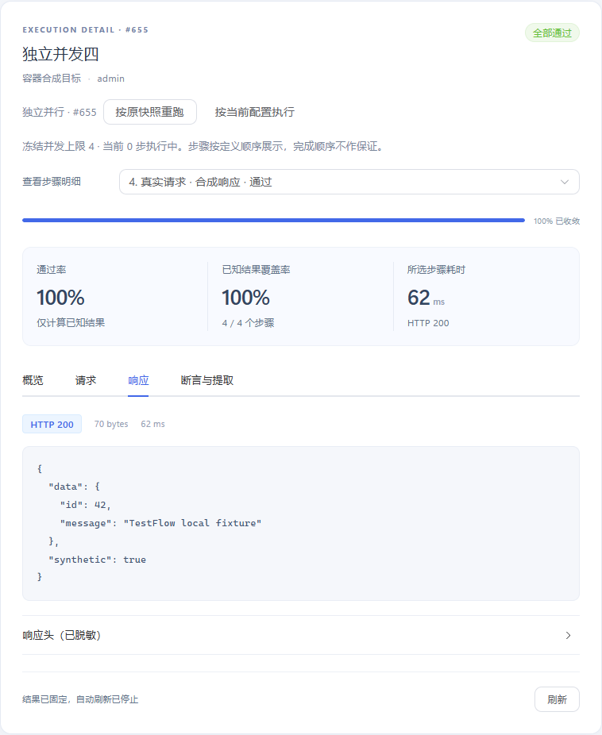
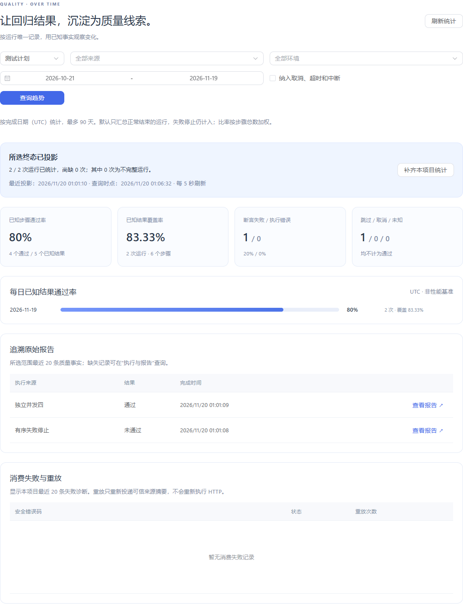
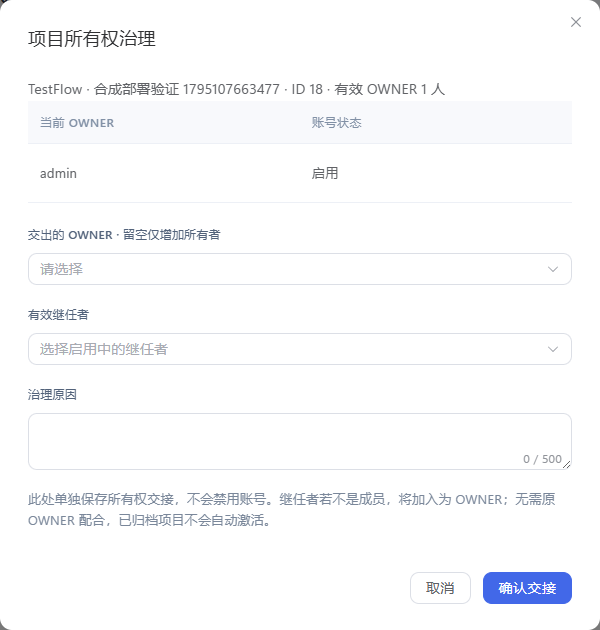

# TestFlow

面向个人开发者和小型研发团队的 API 自动化测试与质量管理平台。通过 Web 管理端配置接口、组织回归、查看执行报告和质量趋势。

这是独立设计与实现的 Java 后端作品，参考成熟测试平台的业务分层思路，重点展示持久化异步任务、并发控制、数据库事务和故障处理。

## 能做什么

| 场景 | 功能 |
| --- | --- |
| 管理接口回归 | 项目、环境、普通与敏感变量、HTTP 用例、声明式断言、JSON 字段提取 |
| 串联业务流程 | 有序计划按步骤执行，前一步提取的 Token 或 ID 可供后一步使用 |
| 执行独立检查 | 无步骤间变量依赖的计划支持有界并发、失败停止和取消 |
| 追溯测试结果 | 保存执行配置快照、步骤报告及历史记录，支持按原快照重跑 |
| 观察质量变化 | 按来源、环境和日期统计趋势，展示统计延迟并支持补齐 |
| 管理协作权限 | 项目角色隔离、管理员所有权交接、账号禁用与交接一次提交 |

## 技术与关键设计

后端采用 **Java 21、Spring Boot 4.1.2、MyBatis Starter 4.1.0、MySQL 8.4 LTS**；前端采用 **Vue 3、TypeScript、Vite、Element Plus**，使用 Docker Compose 与 Nginx 完成本地部署。

- **API + 独立 Worker**：管理请求与外部 HTTP 执行分开运行，MySQL 保存任务和结果。
- **配置快照与任务幂等**：提交后编辑用例不影响本次运行，网络重试不会重复创建任务。
- **租约与故障识别**：拒绝过期 Worker 写结果；无法确认的请求记为 UNKNOWN，不自动重发。
- **Outbox + Kafka**：运行终态和事件在同一数据库事务保存；重复消费不重复统计，Kafka 离线不阻断执行和报告。
- **Redis 与权限安全**：会话、登录限速、CSRF，以及目标授权、DNS/TLS 校验和请求限制。

架构图、时序图和具体取舍见 [系统设计](docs/ARCHITECTURE.md)。

## 如何运行

**首次使用或日常演示：阅读 [运行与部署](docs/DEPLOYMENT.md#1-首次运行或代码更新)。**

该手册集中说明首次构建、再次启动、停止、账号位置和排障。默认推荐完整 Docker 运行，浏览器入口为 **18081**；IDEA/Vite 开发调试方式位于同一手册附录，入口为 **5173**。两种方式使用独立数据和凭据，不能混用。

## 界面

执行报告：区分断言失败、执行错误和未知结果，可以查看步骤详情及按原快照重跑。

质量趋势：同时展示已知结果覆盖率、通过率和统计是否补齐。

项目治理：管理员可交接项目所有权，但不会因此获得项目业务访问权限。

## 文档怎么读

| 目录 | 放什么 |
| --- | --- |
| `testflow-api`、`testflow-core`、`testflow-persistence`、`testflow-worker` | 管理API、执行引擎、数据库访问、独立执行进程 |
| `frontend/` | Vue管理端源码 |
| `deploy/` | 运行镜像、Nginx、数据库初始化和健康检查配置 |
| `scripts/` | 三个主入口；其余按开发、部署辅助、测试、测量和公共函数分类 |
| `docs/` | 六份正式说明和精选产品截图 |

| 你想了解什么 | 对应文档 |
| --- | --- |
| 面向谁、有哪些功能、业务规则是什么 | [需求分析](docs/PRD.md) |
| 系统怎样工作、为什么这样设计 | [系统设计](docs/ARCHITECTURE.md) |
| 表怎么关联、字段和索引是什么 | [数据库设计](docs/DATABASE.md) |
| 如何调用接口、需要哪些参数和权限 | [接口设计](docs/API.md) |
| 如何启动、停止、更新和开发调试 | [运行与部署](docs/DEPLOYMENT.md) |
| 测了什么、如何复现、哪些尚未验证 | [测试说明](docs/TESTING.md) |

## 适用范围

当前定位为可本地部署和演示的单机作品。未提供公开注册、定时调度、任意脚本、复杂流程设计器或执行集群；也不承诺生产高可用。HTTPS、独立备份恢复、自动归档清理及长期稳定性仍有待完善，具体范围见测试说明。
