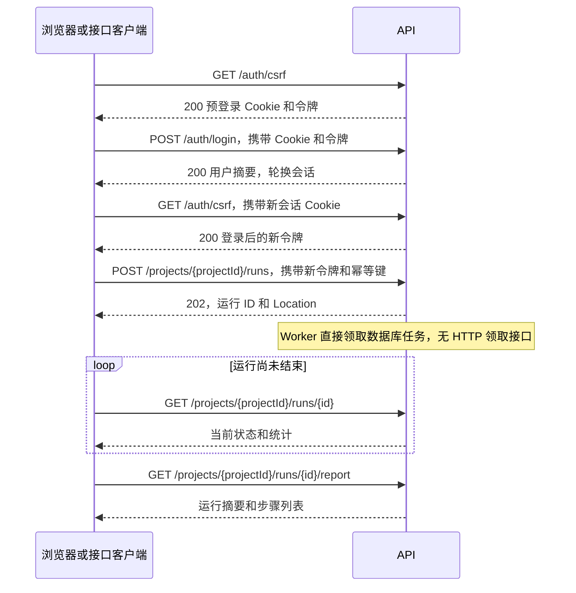

# API 接口说明

本文说明当前实现的 HTTP 接口，供前端开发、接口调试和项目评审使用。所有业务路径统一以 `/api/v1` 开头。以下表格省略此前缀。

运行地址与配置见[部署说明](DEPLOYMENT.md)；状态和故障处理见[系统设计](ARCHITECTURE.md)；统计公式见 PRD 的[统一计算口径](PRD.md#62-统一计算口径)。本文中的 ID、账号、URL、令牌和数据均为示例，不是默认登录凭据或实测记录。

## 1. 先看调用规则

### 1.1 请求、响应和分页

| 约定 | 当前行为 |
| --- | --- |
| 数据格式 | UTF-8 JSON；修改请求发送 `Content-Type: application/json` |
| ID | JSON 中的 ID 使用正整数字符串；路径 ID 对应正整数，不能传业务名称 |
| 时间 | 含时区的 ISO 8601，响应使用 UTC，例如 `2026-11-20T08:00:00Z` |
| 成功响应 | `{ "data": ..., "requestId": "..." }`；HTTP 状态仍需单独判断 |
| 错误响应 | `{ "error": { "code": "...", "message": "...", "fieldErrors": [] }, "requestId": "..." }` |
| 请求追踪 | 响应头 `X-Request-Id` 与响应体 `requestId` 用于定位问题 |
| 分页 | `page` 默认 1，范围 1～100000；`size` 默认 20，范围 1～100 |
| 列表响应 | `data` 为 `{ "items": [], "page": 1, "size": 20, "total": 0 }`；无通用自定义排序参数 |
| 请求大小 | API 请求体最多 1 MiB；执行快照另有上限，可能返回 `SNAPSHOT_TOO_LARGE` |
| 严格字段 | DTO 请求不接受未定义字段；正文中的 `config` 按其配置规则校验 |
| PATCH | 必须提交当前 `version`；其他可选字段省略或为 `null` 时通常表示保留原值，不能用 `null` 清空 |
| 编辑冲突 | `409/VERSION_CONFLICT`：重新读取数据，让用户确认后再提交，不自动覆盖 |
| 归档 | 定义状态为 `ACTIVE` 或 `ARCHIVED`；归档不删除历史运行，接口不提供物理删除定义的操作 |

分页示例：

```json
{
  "data": {
    "items": [{ "id": "101", "name": "订单服务", "status": "ACTIVE", "role": "OWNER", "version": 0 }],
    "page": 1,
    "size": 20,
    "total": 1
  },
  "requestId": "example-request-id"
}
```

### 1.2 会话、CSRF 和权限

登录态由 Redis Session 和 `HttpOnly` Cookie `TESTFLOW_SESSION` 管理。调用方须保存并随请求发送 Cookie；不要将会话凭据放入 localStorage。所有修改请求都携带 `X-CSRF-TOKEN`，包括登录和退出。登录成功会轮换会话并清除旧 CSRF 令牌，因此必须再读取一次令牌。



轮询读取的是 MySQL 中已保存的状态，不依赖 Kafka。读取 CSRF 时创建或复用当前会话；登录后必须继续使用响应更新后的 Cookie。

| 权限缩写 | 可以做什么 |
| --- | --- |
| 登录用户 | 读取自己可见的项目列表和个人会话 |
| VIEWER | 读取所属项目的环境、用例、计划、运行和质量数据 |
| MAINTAINER | 包含 VIEWER；编辑环境、用例、计划，提交、取消和重跑执行，补齐质量统计 |
| OWNER | 包含 MAINTAINER；管理成员和项目名称、归档状态 |
| 系统管理员 | 创建项目、管理平台账号、目标访问策略和项目所有权；不自动拥有项目业务权限 |

系统管理员即使不是成员，也可使用专用治理接口；不能因此读取该项目环境、用例、秘密或报告。非成员访问普通项目接口返回 404；已是成员但角色不足返回 403。归档项目仍可查询，但不能编辑业务定义或创建新运行。

### 1.3 错误码和错误详情

| HTTP | 错误码 | 调用方处理 |
| --- | --- | --- |
| 400 | `VALIDATION_ERROR` | 检查字段、枚举、JSON 结构、筛选条件和变量引用 |
| 401 | `BAD_CREDENTIALS`、`UNAUTHENTICATED` | 账号密码错误，或重新登录；不要重复使用失效会话 |
| 403 | `FORBIDDEN`、`CSRF_INVALID` | 权限不足，或重新获取 CSRF 令牌 |
| 403 | `TARGET_NOT_AUTHORIZED`、`TARGET_BLOCKED` | 目标未授权或被安全执行规则阻止；不要绕过校验 |
| 404 | `RESOURCE_NOT_FOUND` | 资源不存在、不属于该项目或对当前用户不可见 |
| 405 / 415 | `METHOD_NOT_ALLOWED` / `UNSUPPORTED_MEDIA_TYPE` | 修正 HTTP 方法或 JSON 媒体类型 |
| 409 | `VERSION_CONFLICT`、`CONCURRENT_MODIFICATION` | 数据过期或并发冲突；刷新后重新确认 |
| 409 | `STATE_CONFLICT` | 资源归档、名称冲突或关联约束不满足 |
| 409 | `IDEMPOTENCY_CONFLICT` | 相同键不能用于不同执行请求；新操作使用新 UUID |
| 409 | `LAST_OWNER`、`LAST_ADMIN`、`OWNER_TRANSFER_REQUIRED` | 保留有效负责人；缺少交接时展示项目详情 |
| 409 | `RUN_NOT_TERMINAL`、`SNAPSHOT_UNAVAILABLE` | 原运行未结束或快照不可用，不能按原快照重跑 |
| 409 | `EVENT_UNAVAILABLE`、`EVENT_IN_FLIGHT` | 无可信来源事件，或事件投递中，不能立即重放 |
| 413 | `PAYLOAD_TOO_LARGE`、`SNAPSHOT_TOO_LARGE` | 减少请求体或执行配置大小 |
| 429 | `RATE_LIMITED` | 登录尝试过多；响应含 `Retry-After: 300` |
| 503 | `DEPENDENCY_UNAVAILABLE` | 数据库、会话或登录限速服务暂不可用 |
| 500 | `INTERNAL_ERROR` | 保留 `requestId` 排查，不向用户显示内部异常堆栈 |

`fieldErrors` 有两种已实现的结构，必须结合 `error.code` 解析，不能一律当成表单字段错误：

```json
{
  "error": {
    "code": "VALIDATION_ERROR",
    "message": "请检查输入字段",
    "fieldErrors": [{ "field": "name", "message": "不能为空" }]
  },
  "requestId": "example-validation-request"
}
```

`OWNER_TRANSFER_REQUIRED` 的 `fieldErrors` 则是缺少交接的项目摘要，完整示例见[账号禁用](#82-账号禁用与交接)。其他错误可返回空数组。密码、秘密和完整请求体不会写入这些详情。

## 2. 登录与退出

| 方法与路径 | 请求 | 响应 data / HTTP |
| --- | --- | --- |
| `GET /auth/csrf` | 无需登录 | `{token,headerName}` / 200 |
| `POST /auth/login` | `{username,password}`；预登录 CSRF | 用户摘要 / 200 |
| `GET /auth/me` | 当前会话 | 用户摘要 / 200 |
| `POST /auth/logout` | 当前 Cookie 与 CSRF，使用 JSON 媒体类型 | `{loggedOut:true}` / 200 |

登录 `username` 必填，最多 32 字符；服务端去除首尾空格并转换为小写。`password` 必填，最多 72 字符，认证同时限制 UTF-8 不超过 72 字节。创建及重置密码的要求见[平台账号](#81-账号管理)。没有公开注册接口。

```http
POST /api/v1/auth/login
Content-Type: application/json
X-CSRF-TOKEN: <预登录令牌>
Cookie: TESTFLOW_SESSION=<预登录会话>

{"username":"demo-user","password":"<从本机凭据文件获取>"}
```

```json
{
  "data": { "id": "11", "username": "demo-user", "globalAdmin": false, "status": "ACTIVE", "version": 0 },
  "requestId": "example-login-request"
}
```

`globalAdmin` 是平台身份；项目角色由项目接口返回。账号状态或密码改变后，旧版本会话失效；重新启用账号也必须重新登录。当前限速范围是登录：每个来源 IP 每分钟最多 60 次、同账号与来源 IP 组合每 5 分钟最多 8 次，计数包含成功和失败尝试。

## 3. 项目、成员和目标授权

### 3.1 项目与成员

| 方法与路径 | 权限 | 请求或响应 |
| --- | --- | --- |
| `GET /projects` | 登录用户 | 分页，仅返回当前用户已加入的项目 |
| `POST /projects` | 系统管理员 | `{name,ownerId}` → 项目，201 |
| `GET /projects/{projectId}` | VIEWER | 项目，200 |
| `PATCH /projects/{projectId}` | OWNER | `{version,name?,status?}` → 项目，200 |
| `GET /projects/{projectId}/members` | OWNER | 分页成员列表，200 |
| `GET /projects/{projectId}/members/{userId}` | OWNER | 单个成员，200 |
| `PUT /projects/{projectId}/members/{userId}` | OWNER | `{role,version?}` → 成员，200 |
| `DELETE /projects/{projectId}/members/{userId}` | OWNER | 无请求体 → `{removed:true}`，200 |

| 字段 | 约束与含义 |
| --- | --- |
| 项目 `name` | 创建必填；更新可选；去空格后 1～100 字符 |
| `ownerId` | 创建必填，指定 ACTIVE 账号；创建人不是该 Owner 时不会自动加入项目 |
| 项目 `status` | ACTIVE / ARCHIVED；重新激活时必须有有效 Owner |
| 项目响应 | `{id,name,status,role,version}`；role 是调用者在此项目中的角色，管理员替他人创建时可为 null |
| 成员 `role` | 必填，OWNER / MAINTAINER / VIEWER |
| 成员 `version` | 新增成员时省略；修改已有成员时必填，是成员版本而非项目版本 |
| 成员响应 | `{userId,username,status,role,version}`；status 是账号状态 |

项目和成员版本均为非负整数。有效 Owner 是 ACTIVE 账号且成员角色为 OWNER。降级或移除最后一名有效 Owner 返回 `LAST_OWNER`。成员真正变更会递增项目版本；同角色更新不递增。禁用账号不能新加入项目或提升为 Owner，但可清理已有禁用成员。

### 3.2 目标访问策略

| 方法与路径 | 权限 | 请求或响应 |
| --- | --- | --- |
| `GET /projects/{projectId}/target-policies` | VIEWER 或系统管理员 | 分页策略摘要，200 |
| `POST /projects/{projectId}/target-policies` | 系统管理员 | 创建字段见下表 → 策略，201 |
| `PATCH /projects/{projectId}/target-policies/{policyId}` | 系统管理员 | `{version,enabled}` → 策略，200 |

| 创建字段 | 约束 |
| --- | --- |
| `scheme` | 必填，http / https |
| `host` | 必填，最多 253 字符；精确域名或 IP，不接受通配符、路径或账号 |
| `port` | 必填整数，1～65535 |
| `addressScope` | 必填，PUBLIC / PRIVATE / LOOPBACK；指定允许的解析地址范围 |

返回 `{id,scheme,host,port,addressScope,enabled,version}`；创建后默认启用。PATCH 中 version、布尔 enabled 必填；协议、主机或端口变化须新建策略并禁用旧策略。元数据地址和平台基础设施管理目标不能授权。保存环境不等于批准执行，提交与实际连接都会做安全校验。

## 4. 环境与用例

### 4.1 环境

| 方法与路径 | 权限 | 行为 |
| --- | --- | --- |
| `GET /projects/{projectId}/environments` | VIEWER | 分页，可选 name、status 筛选 |
| `POST /projects/{projectId}/environments` | MAINTAINER | 新增，201 |
| `GET /projects/{projectId}/environments/{environmentId}` | VIEWER | 详情，200 |
| `PATCH /projects/{projectId}/environments/{environmentId}` | MAINTAINER | 带版本更新，200 |

| 字段 | 创建 | PATCH 与约束 |
| --- | --- | --- |
| `name` | 必填 | 可选，1～100 字符 |
| `baseUrl` | 必填 | 可选，最多 2048 字符；HTTP/HTTPS，不能含账号、查询参数、片段或反斜杠 |
| `variables` | 必填，可为 `{}` | 可选；传入则整体替换普通变量映射，最多 100 项；值为字符串，最多 4096 字符 |
| `secretUpdates` | 可选数组 | 可选，最多 100 个更新操作；省略表示保留秘密 |
| `version` | 不传 | 必填，非负整数 |
| `status` | 默认 ACTIVE | 可选，ACTIVE / ARCHIVED |

变量和秘密名称匹配 `[A-Za-z_][A-Za-z0-9_]{0,63}`。每个秘密操作包含 name、operation 和可选 value：SET 必须有非空值且最多 4096 字符；REMOVE 删除该秘密。一次请求不能重复操作同名秘密，最终秘密不超过 100 项，且不得与普通变量重名。

```json
{
  "name": "演示环境",
  "baseUrl": "https://api.example.test",
  "variables": { "tenant": "demo" },
  "secretUpdates": [{ "name": "apiToken", "operation": "SET", "value": "<注入的秘密值>" }]
}
```

详情返回 `{id,name,baseUrl,variables,secretNames,status,version}`；列表项仅含 `{id,name,status,version}`。**只返回秘密名称，不提供读取秘密明文接口**。PATCH 使用 `variables:{}` 可清空普通变量，使用 REMOVE 操作删除秘密。

### 4.2 用例基本字段

| 方法与路径 | 权限 | 行为 |
| --- | --- | --- |
| `GET /projects/{projectId}/cases` | VIEWER | 分页，可选 name、status 筛选 |
| `POST /projects/{projectId}/cases` | MAINTAINER | 新增，201 |
| `GET /projects/{projectId}/cases/{caseId}` | VIEWER | 详情，200 |
| `PATCH /projects/{projectId}/cases/{caseId}` | MAINTAINER | 带版本更新，200 |

| 字段 | 约束 |
| --- | --- |
| `name` | 创建必填；PATCH 可选；去空格后 1～100 字符 |
| `tags` | 可选，最多 20 项，每项非空且最多 32 字符；默认 `[]`，传 `[]` 清空 |
| `priority` | 可选，P0 / P1 / P2 / P3；创建默认 P2 |
| `configSchemaVersion` | 创建必填为 `1`；PATCH 若传也只能为 1 |
| `config` | 创建必填对象；PATCH 可选，传入则整体替换配置 |
| `version`、`status` | PATCH 中版本必填；状态可选 ACTIVE / ARCHIVED |

详情返回 `{id,name,tags,priority,configSchemaVersion,config,status,version}`；列表项为 `{id,name,priority,status,version}`。

### 4.3 请求、断言与提取器配置

以下是完整的创建请求示例，不是待实现的配置格式：

```json
{
  "name": "查询订单",
  "tags": ["订单", "回归"],
  "priority": "P1",
  "configSchemaVersion": 1,
  "config": {
    "request": {
      "method": "GET",
      "path": "/orders/101",
      "query": [{ "name": "tenant", "value": "${env.tenant}" }],
      "headers": [{ "name": "Accept", "value": "application/json" }],
      "body": { "type": "NONE" }
    },
    "timeoutMs": 5000,
    "assertions": [
      { "id": "status", "type": "STATUS_CODE", "expected": 200 },
      { "id": "order", "type": "JSON_EXISTS", "path": "$.data.id" },
      { "id": "state", "type": "JSON_EQUALS", "path": "$.data.status", "expected": "CREATED" }
    ],
    "extractors": [{ "name": "orderId", "path": "$.data.id", "secret": false }]
  }
}
```

| 配置位置 | 约束与示例 |
| --- | --- |
| `request.method` | GET / POST / PUT / PATCH / DELETE / HEAD / OPTIONS |
| `request.path` | 以单个 `/` 起始的相对路径，最多 2048 字符；不得以 `//` 起始，不含反斜杠、片段或换行 |
| `request.query` | 必填数组，可为 `[]`；最多 128 项 `{name,value}`；支持同名参数 |
| `request.headers` | 必填数组，可为 `[]`；同样最多 128 项 `{name,value}` |
| 参数项 | 名称非空、最多 128 字符；值为字符串、最多 4096 字符；不得换行 |
| 受控请求头 | 不允许手工设置 Host、Content-Length、Connection、Proxy-Authorization、Proxy-Connection、Transfer-Encoding、Upgrade、TE、Trailer、Expect |
| `request.body` | 必填对象；`{type:"NONE"}` 或 `{type:"JSON",json:...}`；JSON 类型必须有 json 字段 |
| `timeoutMs` | 可选，整数 1～60000；省略时使用执行器默认值 |
| `assertions` | 必填数组，可空，最多 100 项；id 在用例内唯一，匹配 `[A-Za-z0-9_-]{1,64}` |
| `extractors` | 必填数组，可空，最多 100 项；`{name,path,secret}`，secret 必须显式为布尔值 |
| JSON 路径 | 最多 256 字符，支持 `$.data.id`、`$.items[0].name`；不支持通配符、递归或表达式过滤 |
| 嵌套深度 | 整份配置最多 64 层 |

| 断言类型 | 除 id/type 外的字段 | 判断 |
| --- | --- | --- |
| STATUS_CODE | expected：整数 100～599 | HTTP 状态码相等 |
| HEADER | name、operator；operator 为 EXISTS / EQUALS；EQUALS 必须有字符串 expected | 头名不区分大小写，比较存在性或值 |
| JSON_EXISTS | path | JSON 字段存在 |
| JSON_EQUALS | path、标量 expected | JSON 值及类型相等，例如数字 1 不等于字符串 "1" |
| DURATION_LT | expected：整数 1～60000 | 请求耗时严格小于该毫秒数 |

提取器名称与环境变量名称规则相同，在同一用例内不能重复。只能提取非 null 标量，提取失败会记为步骤 ERROR。`${env.name}` 引用环境普通变量或秘密；ORDERED 后续步骤可用 `${run.orderId}` 引用前序成功步骤的输出。在 JSON 正文或断言期望值中单独使用运行变量可保留标量类型；字符串拼接则得到字符串。INDEPENDENT 计划禁止引用 `${run.*}`。

## 5. 测试计划

| 方法与路径 | 权限 | 行为 |
| --- | --- | --- |
| `GET /projects/{projectId}/plans` | VIEWER | 分页，可选 name、status 筛选 |
| `POST /projects/{projectId}/plans` | MAINTAINER | 新增，201 |
| `GET /projects/{projectId}/plans/{planId}` | VIEWER | 详情，200 |
| `PATCH /projects/{projectId}/plans/{planId}` | MAINTAINER | 带版本更新，200 |

| 字段 | 约束 |
| --- | --- |
| `name` | 创建必填；PATCH 可选；1～100 字符 |
| `executionMode` | 创建必填 ORDERED / INDEPENDENT；PATCH 可选 |
| `failFast` | 布尔值，创建省略为 false；PATCH 省略保留 |
| `maxConcurrency` | ORDERED 必须为 1，默认 1；INDEPENDENT 为 1～4，默认 2 |
| `steps` | 创建必填数组，可保存空草稿，最多 100 项；PATCH 传入则按数组顺序整体替换 |
| 步骤项 | `{caseId,enabled}`；引用同项目 ACTIVE 用例；enabled 为布尔值，省略为 false；同一用例可出现多次 |
| `version`、`status` | PATCH 版本必填，状态可选 ACTIVE / ARCHIVED |

```json
{
  "name": "订单回归",
  "executionMode": "ORDERED",
  "failFast": true,
  "maxConcurrency": 1,
  "steps": [{ "caseId": "201", "enabled": true }, { "caseId": "202", "enabled": true }]
}
```

详情返回 `{id,name,executionMode,failFast,maxConcurrency,steps,status,version}`；列表项省略 steps。PATCH 改变执行模式而不传并发度时，使用新模式默认并发度。只有启用步骤会进入执行快照，提交时要求 1～100 个启用步骤。INDEPENDENT 保存和执行时均校验用例不引用运行变量；失败停止对已启动请求的处理见[系统设计](ARCHITECTURE.md)。

## 6. 异步运行、历史和报告

### 6.1 接口目录

| 方法与路径 | 权限 | 成功状态与 data |
| --- | --- | --- |
| `POST /projects/{projectId}/runs` | MAINTAINER | 新请求 202；同键相同请求 200；Accepted |
| `GET /projects/{projectId}/runs` | VIEWER | 200，分页运行摘要 |
| `GET /projects/{projectId}/runs/{runId}` | VIEWER | 200，运行摘要 |
| `GET /projects/{projectId}/runs/{runId}/items` | VIEWER | 200，分页步骤摘要 |
| `GET /projects/{projectId}/runs/{runId}/items/{itemId}` | VIEWER | 200，步骤详情 |
| `GET /projects/{projectId}/runs/{runId}/report` | VIEWER | 200，`{run,items}`，可在运行中读取当前已保存结果 |
| `POST /projects/{projectId}/runs/{runId}/cancel` | MAINTAINER | 取消处理后仍未终结时 202；本次同步终结或此前已终结时 200；返回运行摘要 |
| `POST /projects/{projectId}/runs/{runId}/reruns` | MAINTAINER | 新重跑 202；同键相同重跑 200；Accepted |

### 6.2 提交、取消与原快照重跑

提交和重跑必须携带标准 UUID 形式的 `Idempotency-Key`。作用域为“项目 + 提交账号 + 键”。同键相同请求返回原运行，即使原运行已结束；同键不同请求返回 409。网络断开、响应丢失或 5xx 后，应使用原键和原请求确认结果，不能立即换键造成重复执行。

| 提交字段 | 约束 |
| --- | --- |
| `sourceType` | 必填 CASE / PLAN |
| `sourceId` | 必填，用例或计划 ID |
| `environmentId` | 必填，同项目活动环境 ID |
| `overrides` | 可选对象；仅接受以下两项 |
| `overrides.variables` | 可选普通变量映射，最多 100 项，名称规则同环境；每值最多 4096 字符；不能覆盖秘密 |
| `overrides.requestTimeoutMs` | 可选整数 1～60000，覆盖本次所有步骤的请求超时 |

```http
POST /api/v1/projects/101/runs
Content-Type: application/json
X-CSRF-TOKEN: <登录后的令牌>
Idempotency-Key: 73014b58-d42e-4d82-94c4-1a43fdab701f
Cookie: TESTFLOW_SESSION=<当前会话>

{"sourceType":"PLAN","sourceId":"301","environmentId":"401","overrides":{"variables":{"tenant":"demo"},"requestTimeoutMs":5000}}
```

```http
HTTP/1.1 202 Accepted
Location: /api/v1/projects/101/runs/501
Content-Type: application/json

{"data":{"id":"501","state":"QUEUED","outcome":null,"detailUrl":"/api/v1/projects/101/runs/501"},"requestId":"example-submit-request"}
```

返回 202 表示任务和执行快照已经提交数据库，不表示请求已经执行，也不要求当前已有在线 Worker。Location 和 detailUrl 均指向运行查询接口。

取消发送 JSON 媒体类型，可用空对象；取消不回滚外部 HTTP 副作用。原快照重跑的正文**必须为 `{}`**，不能覆盖环境、变量或用例配置；原运行必须已经终结，快照和当前目标授权必须仍有效。按当前配置重新执行应再次调用提交接口并使用新键；重跑成功后新运行的 parentRunId 指向原运行。

### 6.3 历史筛选

`GET /projects/{projectId}/runs` 除分页参数外支持：

| 参数 | 值与规则 |
| --- | --- |
| `sourceType` | CASE / PLAN |
| `sourceId` | 指定时必须同时传 sourceType |
| `environmentId` | 环境 ID |
| `state` | QUEUED / RUNNING / CANCELLING / COMPLETED / CANCELLED / TIMED_OUT / INTERRUPTED |
| `outcome` | PASSED / FAILED / INCOMPLETE |
| `createdFrom`、`createdTo` | 含时区 ISO 8601；开始包含、结束不包含；同时提供时开始必须早于结束 |

状态、结论和步骤状态的区别见[系统设计](ARCHITECTURE.md)。特别是 COMPLETED 只说明执行流程结束，outcome 才表达测试结论。

### 6.4 运行与报告字段

| 对象 | 字段 |
| --- | --- |
| 运行来源 | `id,sourceType,sourceId,parentRunId,sourceName,executionMode,maxConcurrency` |
| 环境与提交者 | `environmentId,environmentName,requestedBy,requestedByName` |
| 当前结果 | `state,outcome,terminalReason,metrics`；未产生的结论或原因可为 null |
| 时间 | `createdAt,queuedAt,startedAt,finishedAt,deadlineAt`；未发生的时间可为 null |
| metrics | `total,passed,failed,errors,skipped,cancelled,unknown,progress,coverage,passRate,failureRate,errorRate` |
| 步骤 Item | `id,ordinal,caseName,state,durationMs,errorCode,startedAt,finishedAt`；ordinal 从 1 开始 |
| 步骤详情 Detail | `{item,result,bodyAvailable,bodyTruncated}`；尚无结果时 result 为 null |
| 报告 Report | `{run,items}`；包含所有步骤摘要，不含全部步骤响应正文 |

以下为单步骤报告的完整响应示例；比率为百分数，分母为零的指标返回 null，公式见 PRD 的[统一计算口径](PRD.md#62-统一计算口径)。

```json
{
  "data": {
    "run": {
      "id": "501", "sourceType": "CASE", "sourceId": "201", "parentRunId": null,
      "sourceName": "查询订单", "executionMode": "ORDERED", "maxConcurrency": 1,
      "environmentId": "401", "environmentName": "演示环境",
      "requestedBy": "11", "requestedByName": "demo-user",
      "state": "COMPLETED", "outcome": "PASSED", "terminalReason": null,
      "createdAt": "2026-11-20T08:00:00Z", "queuedAt": "2026-11-20T08:00:00Z",
      "startedAt": "2026-11-20T08:00:01Z", "finishedAt": "2026-11-20T08:00:02Z",
      "deadlineAt": "2026-11-20T08:10:00Z",
      "metrics": {
        "total": 1, "passed": 1, "failed": 0, "errors": 0, "skipped": 0, "cancelled": 0, "unknown": 0,
        "progress": 100.0, "coverage": 100.0, "passRate": 100.0, "failureRate": 0.0, "errorRate": 0.0
      }
    },
    "items": [{
      "id": "601", "ordinal": 1, "caseName": "查询订单", "state": "PASSED",
      "durationMs": 65, "errorCode": null,
      "startedAt": "2026-11-20T08:00:01Z", "finishedAt": "2026-11-20T08:00:01.065Z"
    }]
  },
  "requestId": "example-report-request"
}
```

需要请求、响应和断言细节时再查步骤详情。成功请求的 result 包含 configurationVersions（caseVersion、environmentVersion）、脱敏后的 request/response、assertions（id、type、passed）、extractors（name、secret、success）及 errorCode；异常结果可能只有错误摘要，不保证存在完整 response。响应正文不能安全展示时，bodyAvailable=false，客户端应说明原因，不能把它误报为空响应。完整快照、环境秘密和原始提取值不通过报告接口返回。

## 7. 质量统计和补齐

| 方法与路径 | 权限 | 请求与响应 |
| --- | --- | --- |
| `GET /projects/{projectId}/quality` | VIEWER | 质量视图，200 |
| `GET /projects/{projectId}/quality/failures` | VIEWER | 分页消费失败记录，200 |
| `POST /projects/{projectId}/quality/reconcile` | MAINTAINER | `{limit?:1..100}`，默认 50 → `{createdEvents,requeuedEvents,limit}`，200 |
| `POST /projects/{projectId}/quality/failures/{failureId}/replay` | MAINTAINER | 正文必须 `{}` → `{status:"REPLAY_REQUESTED"}`，200 |
| `GET /admin/quality/failures/unassigned` | 系统管理员 | 无法安全归属项目的失败记录，最多 100 条，200；不是分页对象 |

质量查询筛选：sourceType、sourceId、environmentId、finishedFrom、finishedTo、includeIncomplete。来源 ID 要同时提供来源类型。默认时间为 UTC 当天及之前 29 天，结束为次日零点；区间为左闭右开，长度必须大于零且不超过 90 天。includeIncomplete 默认 false，只有显式传 true 才将中断、取消、超时运行纳入聚合指标。

| 响应对象 | 字段与解释 |
| --- | --- |
| `status` | `state,enabled,asOf,updatedAt,terminalRuns,projectedRuns,missingRuns,pendingEvents,incompleteRuns,oldestMissingAt` |
| status.state | DISABLED 未启用；LAGGING 存在未投影运行；EMPTY 无终态运行；CURRENT 已补齐 |
| status 的数量 | 在筛选区间统计全部终态运行，包含不完整运行；不受 includeIncomplete 控制 |
| `metrics` | `runs,total,passed,failed,errors,skipped,cancelled,unknown,coverage,passRate,failureRate,errorRate,averageDurationMs` |
| `days` | `[{date,metrics}]`，按 UTC 日期升序；没有数据的日期不会补零 |
| `recent` | 最多 20 项 `{runId,sourceName,state,outcome,finishedAt}` |
| 项目失败记录 | `{id,projectId,eventId,errorCode,status,replayCount,firstSeenAt,lastSeenAt}` |
| 未归属失败记录 | `{id,topic,partition_id,record_offset,eventId,errorCode,status,firstSeenAt}`；两个 Kafka 位置字段沿用当前下划线字段名 |

聚合值是异步生成的。当 missingRuns>0 时应展示“统计更新中”，不能把已有聚合视为全部结果；明细运行和报告仍可查询。补齐或重放只重建质量统计事件，不会重新执行 HTTP 请求，也不允许客户端覆盖事件载荷。

## 8. 平台账号与项目治理

### 8.1 账号管理

| 方法与路径 | 权限 | 请求与响应 |
| --- | --- | --- |
| `GET /admin/users` | 系统管理员 | 分页账号摘要，200 |
| `POST /admin/users` | 系统管理员 | `{username,password,globalAdmin}` → 账号摘要，201 |
| `PATCH /admin/users/{userId}` | 系统管理员 | `{version,status?,password?,ownershipTransfers?}` → 账号摘要，200 |
| `GET /admin/users/{userId}/disable-impact` | 系统管理员 | 禁用影响，200 |

| 字段 | 约束 |
| --- | --- |
| 创建 username | 必填，3～32 字符，首位为字母或数字，其余可用字母、数字、下划线、点、连字符；保存为小写 |
| 创建／重置 password | 至少 12 字符，UTF-8 不超过 72 字节；PATCH 省略表示不修改 |
| 创建 globalAdmin | 布尔值，省略为 false；当前 PATCH 不提供平台身份修改功能 |
| PATCH version | 必填，非负账号版本 |
| PATCH status | ACTIVE / DISABLED |
| ownershipTransfers | 可选，最多 1000 项；仅 status=DISABLED 时可用，结构见下节 |
| 账号摘要 | `{id,username,globalAdmin,status,version}`，从不返回密码或密码哈希 |

### 8.2 账号禁用与交接

先读取禁用影响，展示每个项目，再一次提交交接和禁用：

```json
{
  "data": {
    "userId": "11",
    "version": 3,
    "projects": [{ "id": "101", "name": "订单服务", "version": 7, "remainingActiveOwners": 0, "requiresTransfer": true }]
  },
  "requestId": "example-impact-request"
}
```

列表仅包含该账号以 OWNER 身份加入的活动项目。remainingActiveOwners 是禁用该账号之后剩余的有效 Owner 数；至少为 1 时不强制交接，为 0 时必须交接。预览不锁定数据，服务端会在提交事务内重新校验。

```http
PATCH /api/v1/admin/users/11
Content-Type: application/json
X-CSRF-TOKEN: <登录后的令牌>
Cookie: TESTFLOW_SESSION=<当前会话>

{"version":3,"status":"DISABLED","ownershipTransfers":[{"projectId":"101","version":7,"successorUserId":"12"}]}
```

每项必须包含项目 ID、**项目版本**和 ACTIVE 继任者 ID。继任者可为现有成员或非成员；分别提升或加入为 OWNER，被明确交接的原 Owner 降为 MAINTAINER。无关项目、重复项目、自己继任自己、禁用账号继任和过期版本均被拒绝，任何失败都会回滚全部交接、账号修改及成功审计。

缺少交接时返回如下详情；前端须显示项目名称和 ID，刷新影响后保留仍适用的选择，让用户重新确认：

```json
{
  "error": {
    "code": "OWNER_TRANSFER_REQUIRED",
    "message": "部分项目需要指定有效继任者",
    "fieldErrors": [{ "id": "101", "name": "订单服务", "version": 7, "remainingActiveOwners": 0, "requiresTransfer": true }]
  },
  "requestId": "example-transfer-request"
}
```

归档项目不阻止禁用，但重新激活前仍须有有效 Owner。未明确交接的项目保留该成员原角色；禁用期间没有访问权，重新启用后按保留角色恢复。最后一名有效系统管理员仍不能禁用。预览加载失败时不能继续提交；不是仅弹出一条泛化提示后让管理员自行查找项目。

### 8.3 跨项目所有权治理

| 方法与路径 | 权限 | 请求与响应 |
| --- | --- | --- |
| `GET /admin/projects` | 系统管理员 | 分页全平台项目摘要 `{id,name,status,version,activeOwners}`，200 |
| `GET /admin/projects/{projectId}/ownership` | 系统管理员 | `{project,owners}`，200 |
| `PUT /admin/projects/{projectId}/ownership` | 系统管理员 | 治理请求 → 更新后的 `{project,owners}`，200 |

owners 每项为 `{userId,username,status,version}`，其中 version 是成员版本；project.version 才是治理写入所需的项目版本。Owner 列表包含禁用账号，应结合 status 判断有效性。

| 治理请求字段 | 约束 |
| --- | --- |
| `version` | 必填，非负项目版本 |
| `successorUserId` | 必填，ACTIVE 账号 ID，可为非成员 |
| `fromUserId` | 可选，当前 OWNER 的账号 ID；传入则降为 MAINTAINER，不传则仅新增／提升继任者 |
| `reason` | 必填，去空格后非空，最多 500 字符，进入审计 |

```json
{
  "version": 7,
  "successorUserId": "12",
  "fromUserId": "11",
  "reason": "账号交接，调整项目负责人"
}
```

```json
{
  "data": {
    "project": { "id": "101", "name": "订单服务", "status": "ACTIVE", "version": 8, "activeOwners": 1 },
    "owners": [{ "userId": "12", "username": "demo-successor", "status": "ACTIVE", "version": 0 }]
  },
  "requestId": "example-governance-request"
}
```

此操作可修复活动或归档项目的所有权。它独立完成交接，**不会自动禁用原账号**；账号禁用弹窗内的交接则与禁用同事务提交。普通成员管理和平台治理共享最后一名有效 Owner 保护，管理员不需要原 Owner 配合，但仍不会因治理自动获得项目业务权限。
