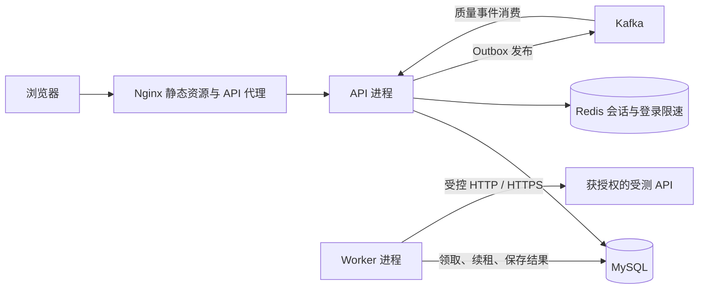
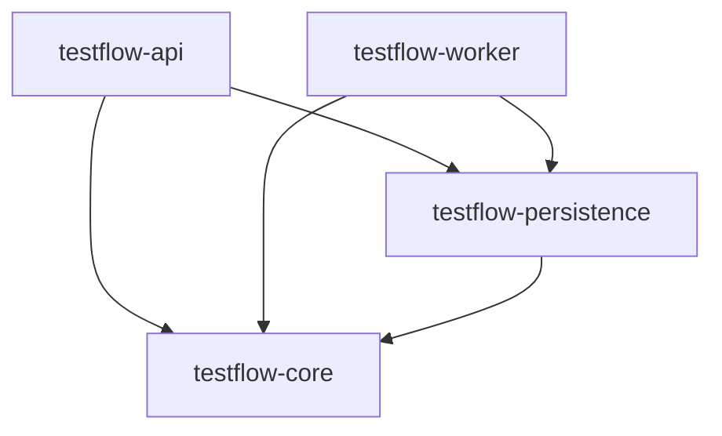
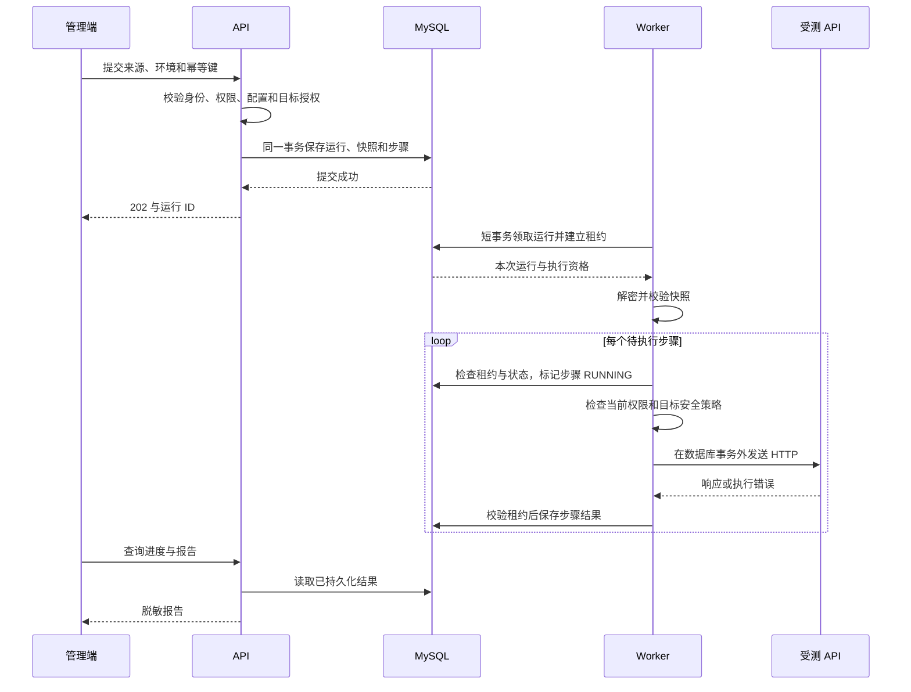
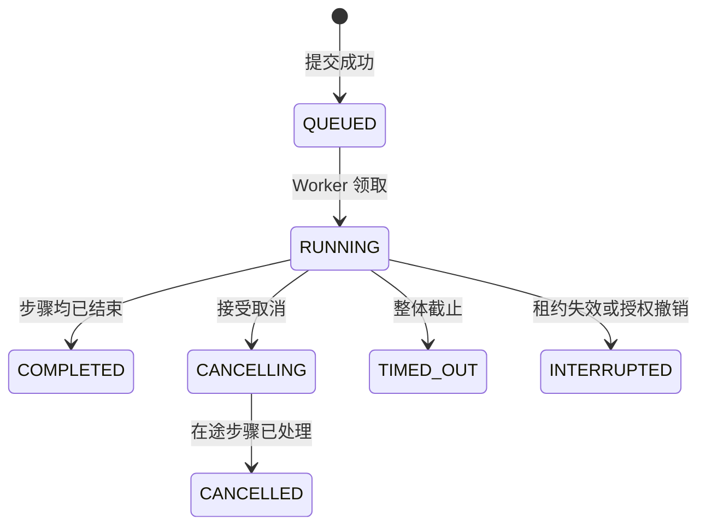
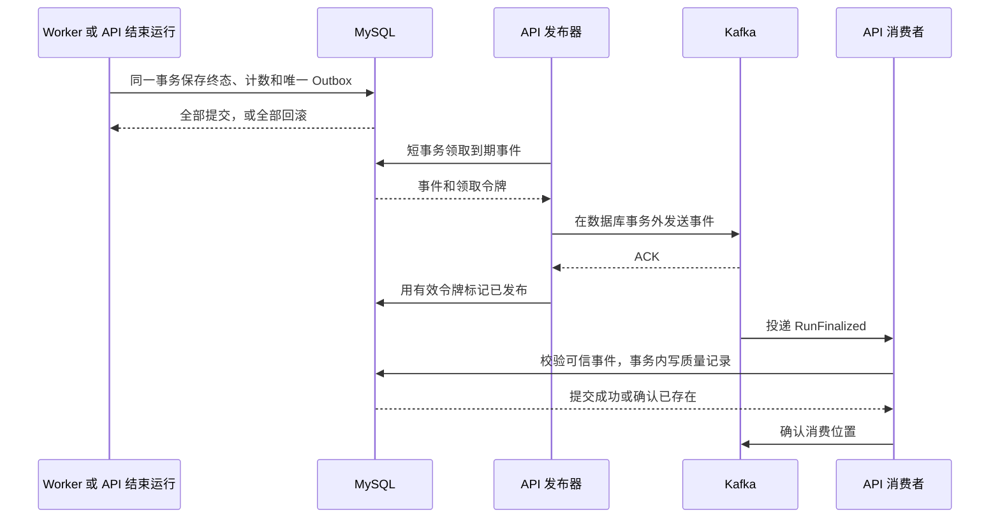

# TestFlow 架构设计

TestFlow 采用**模块化单体 API + 独立 Worker + MySQL 持久任务**。API 负责管理和查询，Worker 负责向受测系统发送请求；两个进程独立运行，避免慢请求占满管理端的线程和内存。

本文解释当前实现与设计取舍。业务规则和指标公式见[需求分析](PRD.md)，表结构见[数据库设计](DATABASE.md)，HTTP 契约见[接口设计](API.md)。启动、配置和网络地址统一见[部署手册](DEPLOYMENT.md)，实际验证范围见[测试说明](TESTING.md)。

## 1. 系统组成与模块职责

### 1.1 运行时架构

MySQL 保存任务、配置快照、结果和统计恢复依据，执行状态以数据库为准。Redis 只用于会话和登录限速；Kafka 只更新质量统计，均不承担测试任务分发。单用例调试也经过持久化任务链路，API 不直接调用受测接口。

默认部署一个 API 和一个 Worker。Outbox 发布器、质量消费者都在 API 内运行，不额外拆服务；独立 Worker 也不等于执行集群或系统级网络沙箱。这里描述应用执行链路与 Kafka 解耦；完整部署脚本仍会启动 Kafka 并等待健康，具体行为见部署手册。

### 1.2 代码模块与依赖

箭头表示代码依赖。API 与 Worker 不相互依赖；只有这两个应用模块打包成可执行 Boot JAR，其余是普通 JAR。

| 模块 | 负责什么 | 不负责什么 |
| --- | --- | --- |
| Core | 快照协议、断言、提取、变量、受控 HTTP 引擎和必要持久化接口 | 不包含 Controller、Mapper、SQL 和会话配置 |
| Persistence | Entity、Mapper、显式 SQL、领取与结果事务、迁移 SQL 资源 | 不依赖应用模块，不执行 HTTP，不引入 Flyway 运行依赖 |
| API | 参数与权限校验、配置管理、提交与取消、查询、迁移、Outbox 发布和质量消费 | 不在 Controller 中执行测试，不把 HTTP 放进数据库事务 |
| Worker | 领取、心跳、步骤编排、引擎调用、结果提交、停止处理和节点登记 | 不提供 Web 接口，不依赖 Redis、Kafka 或 Flyway |

HTTP 引擎接收配置快照、变量、取消信号和限制，返回结构化结果，不直接访问数据库。Worker 编排层通过持久化接口检查执行资格并提交结果，Mapper 只负责 SQL。

## 2. 技术选择与依赖

| 技术 | 当前用途与选择理由 |
| --- | --- |
| Java 21、Spring Boot 4.1.2 | MVC、事务、安全、校验与配置；用有界平台线程池控制本地资源 |
| MyBatis Starter 4.1.0、MySQL 8.4 LTS | 显式 SQL、条件更新和短事务，能够直接检查领取逻辑与执行计划 |
| Redis | Spring Session 和登录限速，不增加 Redis 任务队列或分布式执行锁 |
| Kafka | 在执行结束后异步汇总质量，允许统计短暂落后于原报告 |
| Apache HttpClient 5 | 绑定校验后的连接地址，控制超时、重定向和响应大小 |
| Jackson 3 | 配置、快照和结果的结构化序列化 |
| Vue 3、TypeScript、Vite、Element Plus | 管理端；使用局部组件状态，未增加路由或全局状态组件 |
| Maven Wrapper、Docker Compose、Nginx | 统一构建入口、单机部署、静态资源和 API 反向代理 |

根 POM 使用 Boot parent 管理版本，MyBatis Starter 显式固定 4.1.0，不同时混用 JPA。构建文件是依赖版本的依据，不为匹配 MySQL 服务端版本而强行覆盖 JDBC 驱动版本。

Boot 4 使用模块化 Starter，当前声明如下：

| 使用处 | 依赖约定 |
| --- | --- |
| API | webmvc、validation、security、session-data-redis、actuator、flyway、kafka；MySQL Flyway 支持使用 `flyway-mysql` |
| Worker | validation、actuator、jackson；没有 Web、Redis、Kafka 或 Flyway Starter |
| Persistence | MyBatis Starter 和 MySQL JDBC runtime；迁移 SQL 仅作为资源 |
| Core | Jackson databind、HttpClient 等直接依赖，不引入 Web Starter |
| 测试 | API 按用途引入 webmvc-test、security-test，Core/Worker 使用 starter-test |

webmvc 提供 Jackson 和 Web 容器，session-data-redis 提供 Redis，MyBatis 提供 JDBC/Hikari。业务 JSON 使用 `tools.jackson`；兼容使用的 Jackson annotations 坐标不代表混用了两套业务 JSON 引擎。Worker 的 Actuator 不建立 HTTP 监听，健康通过进程、数据库心跳和容器心跳文件观察。

## 3. 一次运行如何执行

这是正常执行主线，取消和故障分支见第 4 节。心跳使用独立调度线程定期续租，不依赖 HTTP 调用及时返回；整个外部请求期间不持有数据库行锁。

### 3.1 执行快照：固定当次输入

提交时在同一事务内读取配置并保存运行、步骤和快照，记录来源版本、步骤顺序、环境、请求模板、断言、提取器、模式和并发限制。Worker 按快照执行，不读取最新用例正文来补齐输入；以后编辑或归档来源不会改写本次任务。

快照内容使用 `TF_SNAPSHOT_HMAC_KEY` 计算 HmacSHA256 摘要，以便校验完整性；完整内容用独立 `TF_SECRET_KEY` 进行 AES-GCM 认证加密。密钥不复用、不入库，随机 nonce 不参与内容一致性判断，摘要不对外提供。Worker 到执行边界才解密，浏览器和日志只获得脱敏信息。

当前新快照协议为 3，冻结执行模式和并发上限。旧协议 1/2 先验证历史原始 HMAC，再在内存补充 ORDERED/1 默认值，不修改历史密文。原快照重跑创建新运行、关联原运行，重新提取动态响应值，不复用上一次令牌或业务数据。

### 3.2 提交幂等：网络重试不重复建任务

幂等表示同一次逻辑提交重复到达时，仍只创建一个运行。唯一约束为 `(project_id, requested_by, idempotency_key)`；客户端网络重试沿用原键，主动发起新执行使用新键。

处理顺序为权限校验 → 查已有键 → 比较操作和规范化请求 → 仅对新键读取当前定义、生成快照。同键同参数返回原运行；同键不同参数或操作返回 409。两个请求同时创建同键时由唯一约束裁决，冲突方重新读取，不创建第二个任务。

请求摘要保留数组顺序和字符串语义，不使用当前可变定义或随机密文。即使用例后来被编辑，同一逻辑请求的重试仍返回原运行；但权限撤销后不能借幂等查询读取旧记录。运行保留期间不能先删除幂等绑定再允许旧键重新建任务。

### 3.3 变量和有界并发

ORDERED 在同一运行内传递前序提取值。只有步骤通过、结果提交成功后才发布该步全部值；失败时不发布部分值，并清除该失败步骤声明名称的旧值。上下文只在 Worker 内存中存在，不回写环境或快照，中断后不自动恢复。

`${env.name}` 使用环境字符串；JSON 正文和断言 expected 中完整的 `${run.name}` 保留标量类型，嵌入文本、路径、Header、Query 时转为字符串，不拼接 JSON 文本。提交时验证可判断的引用，运行时缺值则记录 ERROR，不发送带占位符的请求。敏感输入或敏感提取产生的值保守地继续视为秘密。

INDEPENDENT 禁止 `${run.*}`。保存时检查所有引用，提交时再次检查启用用例，避免用例编辑后绕过限制；每个步骤使用隔离上下文，不发布共享运行变量。

`ExecutionWorker` 用独立协调线程管理运行，ORDERED 和 INDEPENDENT 共用 `BoundedStepPool`。先取得空闲线程预算，再调用 `RunStore.begin`；满载时步骤留在数据库 PENDING，不把所有步骤塞进内存队列。数据库再次检查运行内并发，避免仅靠线程池控制。

每运行最多保留 maxConcurrency 个在途任务；执行和协调线程分开，避免父任务占满池后等待子任务。取消 Future 不提前归还容量，实际执行函数退出时才释放。限额属于单个 Worker，不是跨 Worker 的全局配额。

| 当前默认值或上限 | 数值 |
| --- | --- |
| 同时领取运行 | 单 Worker 最多 2 个 |
| HTTP 总并发 | 单 Worker 默认 4，配置范围 1～4 |
| 运行内并发 | ORDERED 固定 1；INDEPENDENT 为 1～4，创建默认 2 |
| 请求时限 | 连接 3 秒；单请求默认 15 秒，上限 60 秒 |
| 整体时限与规模 | 默认 10 分钟，上限 30 分钟，包含排队；最多 100 步 |
| 输入和响应 | 管理 API 请求体 1 MiB；加密前快照 4 MiB；解压后响应体 1 MiB |
| 提取值和运行变量 | 单值 JSON UTF-8 4096 字节；最多 1000 个变量、累计 4 MiB |

响应按流读取并累计限制，超限记 ERROR，不能拿截断正文判断通过。连接、读取、解压和断言受总时限约束；这些限制是资源保护，不是性能或容量承诺。

## 4. 状态、租约和故障处理

### 4.1 运行状态与测试结果分开

图中展示主要路径。排队时也可能直接取消或超时；CANCELLING 也可能超时或中断；执行中取消但没有在途步骤时可直接结束为 CANCELLED。完整条件见第4.3节的处理表，所有终态均没有回到队列的路径。

| 状态 | 含义 |
| --- | --- |
| QUEUED / RUNNING | 已入库待领取 / Worker 正在执行 |
| CANCELLING | 已记录取消要求，正在处理中止和已有结果 |
| COMPLETED | 正常执行流程结束，包括因失败停止而结束；不代表测试通过 |
| CANCELLED / TIMED_OUT / INTERRUPTED | 用户取消 / 整体超时 / Worker 失联、租约失效或授权撤销等中断 |

COMPLETED、CANCELLED、TIMED_OUT、INTERRUPTED 为终态，不能倒退，也不接受晚到结果覆盖。`outcome` 未结束时为 null；COMPLETED 且全部通过为 PASSED，存在 FAILED/ERROR 为 FAILED；取消、超时、中断为 INCOMPLETE。其他既非全通过又无明确失败的结束情况也不推定通过。

步骤与运行分别记录状态：

| 步骤状态 | 含义 |
| --- | --- |
| PENDING / RUNNING | 尚未开始 / 已进入请求执行阶段 |
| PASSED / FAILED | 断言通过 / 已获得响应但断言失败 |
| ERROR | 可以明确记录的解析、变量、连接、请求超时等执行错误 |
| SKIPPED | 因失败停止、整体超时或系统中断而未开始 |
| CANCELLED | 用户取消时能够确认尚未开始 |
| UNKNOWN | 请求可能已发送，但平台不能确认最后结果 |

ERROR 和 UNKNOWN 都不能证明目标端没有产生副作用。UNKNOWN 不伪造 HTTP 响应，不并入通过或断言失败。

### 4.2 租约和旧 Worker 写入隔离

**租约**是 Worker 在有限时间内执行某运行的资格，包含进程 owner、`lease_version` 和到期时间。Worker 启动生成新进程 UUID，领取时用短事务 `SELECT … FOR UPDATE SKIP LOCKED` 选取 QUEUED 运行，递增版本并更新租约；有空闲运行槽才领取，按创建时间和 ID 尽力先来先处理，不保证严格 FIFO 或项目公平。

默认每 5 秒续租、30 秒过期，使用数据库时间。每次开始步骤、写入结果、更新计数和结束运行，都在短事务中先锁运行，检查 owner、租约版本、到期时间和允许状态，再写所属数据。CANCELLING 只允许处理已经开始的请求，不允许开始新请求。恢复处理使原租约版本失效，旧 Worker 恢复连接也不能覆盖终态。

例如 Worker A 发出请求后断网，租约过期，API 将运行标记为中断；A 稍后带着响应回来，它携带的旧租约无法再保存结果。平台保留 UNKNOWN，不能为了补结果重新执行一次 HTTP。

### 4.3 结果事务、取消与故障恢复

步骤先在数据库记为 RUNNING，再发送 HTTP；这两件事不能构成跨系统原子操作。若进程恰好在二者之间退出，也保守视为结果未知。响应、断言、步骤终态和计数在租约校验事务中提交，同一步只保留一份最终结果；持有效租约时可以重试保存同一结果，不能重新调用目标来补结果。

| 情况 | 运行和步骤如何处理 |
| --- | --- |
| 失败停止 | 持久化 FAIL_FAST 原因，将未开始步骤置 SKIPPED；已开始的继续保存结果，全部结束后 COMPLETED |
| 排队取消 | 同一事务将运行和未开始步骤置 CANCELLED |
| 执行中取消 | 记录 CANCELLING，停止新步骤并尽力中止请求；确定结果保留，不确定项 UNKNOWN，未开始项 CANCELLED，最后结束运行 |
| 单请求超时 | 该步 ERROR；是否继续由失败停止选项决定 |
| 整体截止 | 未开始项 SKIPPED，不确定项 UNKNOWN，运行 TIMED_OUT |
| Worker 租约过期 | 运行 INTERRUPTED，RUNNING 项 UNKNOWN，PENDING 项 SKIPPED，已完成结果保持 |
| 执行权限或目标授权撤销 | 拒绝新请求；当前待开始项 ERROR/AUTHORIZATION_REVOKED，其余待执行项 SKIPPED，运行 INTERRUPTED，不改写已知结果 |

`terminal_reason=FAIL_FAST` 在运行仍为 RUNNING 时也可能存在，因此只能用 `state` 判断运行是否结束。独立计划失败停止不会改写其他在途步骤；取消会通知每个独立请求控制器。

API 的维护扫描默认每 5 秒处理有限批次，先处理租约过期，再处理其他整体超时；结束前锁行重新判断，使旧执行者失去写入资格。API/数据库停机期间无法扫描，恢复后补处理，5 秒不是精确故障恢复时限。Worker 发现续租或数据库故障时停止新请求，优雅停止时不再领取并尽力保存已有结果。

例如创建订单已到达目标端，但响应返回前 Worker 崩溃。平台不知道订单是否创建，既不猜成失败，也不自动重发；用户先检查目标业务，再决定是否发起新的运行。点击取消同样无法撤销已发送请求，最后一次检查与发送之间仍存在短暂竞争窗口。

## 5. 报告和异步质量统计

### 5.1 原始报告不依赖 Kafka

历史与报告直接查询 MySQL。列表只读摘要，正文按步骤详情加载；报告汇总和步骤列表在同一个只读 REPEATABLE_READ 事务内读取，避免并行完成时把两个时点混在一起。不同 HTTP 查询仍是不同时间的观察。

质量趋势读取“每个运行一条的统计记录”，代码称为质量事实；把事件转换为该记录称为质量投影。它可以稍晚于原始报告完成，统计公式统一见[需求分析](PRD.md)。

### 5.2 Outbox 解决什么问题

Outbox 是和业务数据保存在同一数据库的待发送事件。运行终态和 `RunFinalized` 事件在同一 MySQL 事务保存，避免“运行已结束，但事件因进程退出而丢失”。

发布和消费是独立过程，消费者可能在发布器标记成功前收到事件。Kafka ACK 与数据库更新之间崩溃会造成重复发送，质量记录提交与消费位置确认之间崩溃会造成重复消费；系统允许重复传输，靠数据库唯一约束避免重复统计，不宣称跨 MySQL、Kafka 和外部 HTTP 的端到端恰好一次。

| 环节 | 当前保证与恢复方式 |
| --- | --- |
| 终态写入 | `RunStore.finalizeRun` 统一处理正常完成、取消、超时和中断，终态与唯一事件一起提交；Worker 不带 Kafka 依赖 |
| 发布 | `OutboxStore.claim` 用 SKIP LOCKED 和 15 秒令牌租约领取；独立调度器每轮最多 10 条，失败退避 2～60 秒；旧令牌不能确认 |
| 消费 | `QualityConsumer → QualityProjection.apply` 校验版本、键、计数和持久 Outbox 内容；run_id 主键、event_id 唯一和内容摘要防止重复及冲突覆盖 |
| 消费失败 | 初次失败后重试两次，间隔 500ms；仍失败则按 topic/partition/offset 唯一保存诊断，诊断保存成功后才跳过该位置；保存也失败则等待恢复 |
| 积压修复 | 发布器每轮补最多 20 条历史缺事件，空批后间隔 60 秒；授权用户可补齐或重放可信数据库事件，不接受覆盖事件正文 |

事件不含请求响应正文、变量或密钥；失败诊断不保存不可信消息正文和底层异常。重复消费已有记录时只校验，不覆盖历史统计；重放只修复统计，绝不执行测试 HTTP。

消费者在 API 就绪后由独立调度器尝试启动，Broker DNS 或构造失败不会阻断 API 就绪。消息调度器与任务故障扫描分离，等待 Kafka 不能拖延任务超时处理。

例如 Kafka 停机时，运行照常执行、结果和 Outbox 一起入库，用户仍可读报告；趋势显示 LAGGING，Broker 恢复后发送积压并补齐。CURRENT 仅表示当前查询范围已经补齐，不代表 Kafka 当前健康。趋势以同一个只读事务读取统计、缺失数和原运行引用，缺失记录不被算作零失败。

## 6. 权限、所有权与执行安全

### 6.1 登录和所有权事务

Spring Security + Redis Session 管理登录，Cookie 使用 HttpOnly、合适的 SameSite，HTTPS 部署再启用 Secure；修改请求带 CSRF 令牌，前端不在 localStorage 保存认证凭据。Redis 故障时拒绝无法确认身份的管理操作，不放宽权限；已入库任务仍由 MySQL 和 Worker 管理。

平台管理员身份与项目角色独立，业务操作逐次查询当前账号、项目归属和成员角色。密码或账号状态变更使旧版本会话失效。空用户表首次启动从外部初始化管理员，只存密码哈希；用户表非空时不覆盖或重置已有账号，不提供默认口令和免认证注册。

账号交接与成员修改使用 `GovernanceTransactions`：READ COMMITTED、独立事务，先将相关用户 ID 排序加锁，再按项目 ID 排序加锁。操作者也在用户锁中；等待后复查账号、会话版本、权限和状态，项目锁内按最终状态计算有效 Owner。

禁用先锁目标用户和请求中的继任者，再查询该用户的活动 Owner 项目；成员增减同样先锁目标用户，避免扫描遗漏并发新增的所有权。管理员集合查询刷新 MyBatis 一级缓存，集合变化或锁冲突最多进行三次完整事务尝试；每次先回滚再重试，业务校验错误不重试，耗尽返回 409。

`ProjectOwnership` 在项目锁内完成检查、交接和版本递增。继任者加入/提升、原 Owner 降级、账号禁用、成功审计一次提交，任何失败全部回滚。实际成员变更递增项目版本，无变化保存不递增；审计记录原因和身份/角色变化，不含密码或会话。专用治理入口不授予操作者项目业务权限。

### 6.2 SSRF：防止测试请求访问未授权系统

SSRF 指用户借平台发送请求，访问本不该访问的内部或管理地址。TestFlow 不因填写了 Base URL 就允许连接，目标必须同时满足提交时的授权和执行时仍有效的授权。

- 只允许 HTTP/HTTPS；本机和私网由管理员按项目授权精确协议、主机、端口及地址范围，不提供“放开全部内网”。云元数据、平台控制面及基础设施管理地址始终拒绝。
- 统一规范化 IPv4、IPv6、映射地址、主机名和 IP 字面量，校验 DNS 解析后的候选地址，将通过校验的地址绑定实际连接，防止检查后重新解析到其他地址；TLS 仍验证原始主机名。
- 默认关闭自动重试、自动重定向、系统/环境代理，禁止自定义 Host 绕过。每次发送及连接解析时重新检查当前权限和授权，撤销不能撤回已经发出的 HTTP。
- Worker 进程隔离不是完整网络沙箱。Windows、容器和宿主机地址不同，可达地址和授权示例只在[部署手册](DEPLOYMENT.md)维护。

### 6.3 敏感数据和报告

秘密由外部配置注入，环境敏感值和完整快照加密保存，密钥不进入仓库、数据库或报告。请求头、参数、正文中的已知秘密和敏感键需脱敏，错误路径同样受输入和泄密限制。

对带秘密配置、敏感请求头/参数或敏感提取器的请求，响应正文保守地不保存，响应头值隐藏；其他 JSON 按敏感键及已知秘密清理，非结构化正文不保存。断言使用完整但有大小上限的响应，不能拿脱敏或截断文本判断通过；提取摘要仅给名称、敏感标记和成功状态，不公开值。

## 7. 数据迁移和运行边界

迁移脚本在 Persistence 中作为资源提供，**API 是唯一 Flyway 执行方**，使用独立迁移账号执行 DDL。API 普通业务账号和 Worker 账号都无 DDL 权限；Worker 不引入 Flyway，并明确关闭迁移。

当前数据库版本为 6。API 迁移成功后才能就绪，Worker 只读迁移历史，要求最新成功版本与本构建期望版本相等且无失败记录，满足后才登记并领取任务。未初始化、失败或版本不符时明确拒绝工作，不自动建表或猜测兼容。升级先停止 Worker，由 API 迁移，再启动匹配构建，不承诺新旧版本长期混跑。

历史列表按时间和 ID 稳定排序，通过 ID 子查询分页后只取当前页数据；深 OFFSET 仍有线性扫描成本。连接池默认 API 最大 8、Worker 最大 3，索引和约束见[数据库设计](DATABASE.md)。

Compose、日志轮转、秘密挂载、容器资源及操作步骤统一见[部署手册](DEPLOYMENT.md)。当前是单机作品，不承诺集群高可用、任意故障恢复或公网安全部署；卷持久化不是独立备份，当前也没有自动清理历史数据。功能、短时性能与长期稳定性验证分别见[测试说明](TESTING.md)，不能把资源上限或短时结果当作生产容量。
