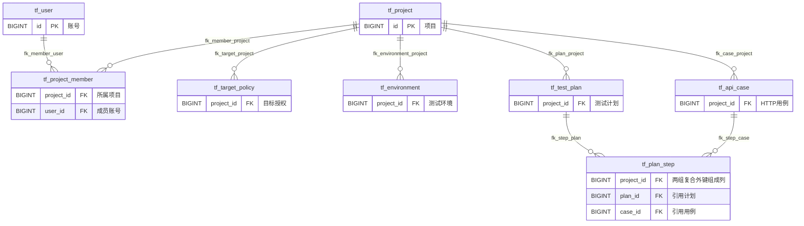
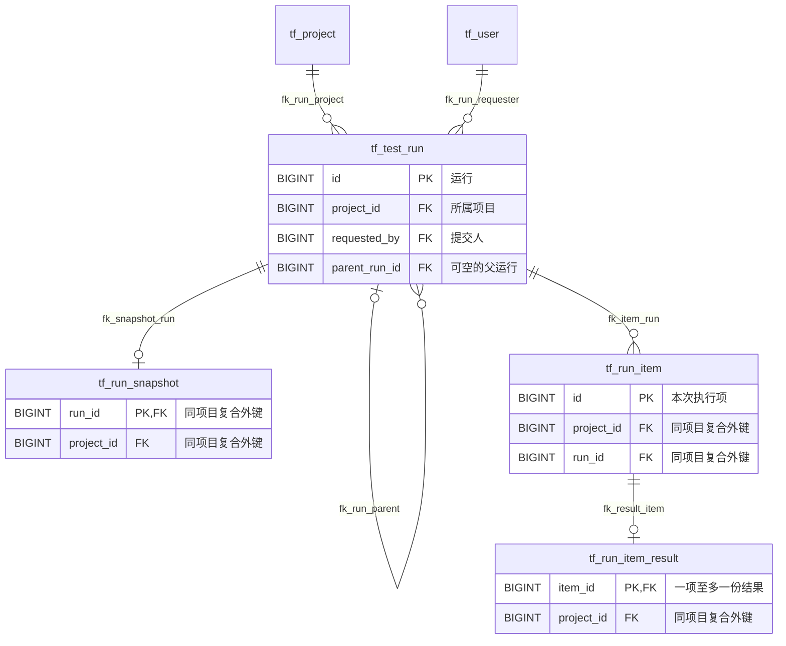
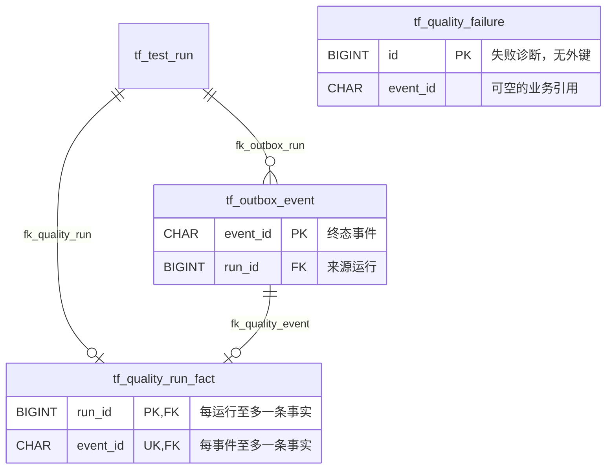
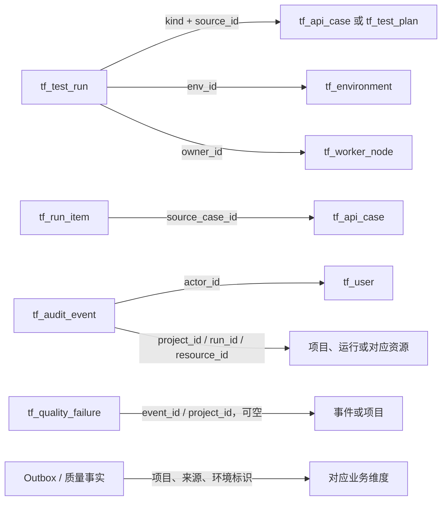

# TestFlow 数据库设计

本文解释数据存在哪里、表如何关联，以及事务怎样保护任务和项目所有权。业务规则见 [需求分析](PRD.md)，状态机与安全机制见 [系统设计](ARCHITECTURE.md)，HTTP 契约见 [接口设计](API.md)。

## 1. 结构总览

结构以 [Flyway 迁移 V1～V6](../testflow-persistence/src/main/resources/db/migration/) 顺序执行后的结果为准，共 **17 张业务表、199 个物理字段、17 个外键、25 个 CHECK**，不计 Flyway 历史表。[Mapper](../testflow-persistence/src/main/java/com/testflow/persistence/mapper/) 用于核对实际读写，不能代替 SQL 定义字段类型和约束。

| 分组 | 表 | 字段数 | 解决的问题 |
| --- | --- | --- | --- |
| 账号与权限 | user、project、project_member | 27 | 谁能访问和管理哪个项目 |
| 测试定义 | target_policy、environment、api_case、test_plan、plan_step | 56 | 允许请求哪里、请求什么、怎样组织执行 |
| 运行与报告 | test_run、run_snapshot、run_item、run_item_result | 57 | 冻结输入、持久任务、结果和历史 |
| 质量统计 | outbox_event、quality_run_fact、quality_failure | 45 | 可靠事件、统计去重与故障补齐 |
| 运维与审计 | worker_node、audit_event | 14 | 节点心跳、重要操作追踪 |

表名均有 `tf_` 前缀。先看关系图，再按需展开字段字典。

**字典约定**

- “默认值”只写 SQL 显式 DEFAULT；`—` 表示未声明。可空字段未赋值可为 NULL，不意味着必填字段也有默认值。
- PK 是主键，UK 是唯一约束，FK 是数据库外键。复合键的完整列顺序列在每张表后；普通索引只列迁移显式声明的名称。
- 主键不可为 NULL，包括 V5 中未重复写 NOT NULL 的主键。BOOLEAN 是 MySQL 类型别名，没有额外 CHECK 时，类型本身不限制只取 0/1。
- DATETIME(3) 保存毫秒精度时间，应用和连接按 UTC 使用。updated_at 只有初始默认值，**没有 ON UPDATE**，修改时间由写入 SQL 更新。
- V1/V2 显式声明 InnoDB、utf8mb4、utf8mb4_0900_ai_ci；V5 建表继承数据库默认设置。幂等键、请求哈希和快照 HMAC 显式使用 ASCII/ascii_bin。
- 结构版本 **6**、用例配置版本 **1**、新快照协议 **3** 分别管理，不能混用；历史快照 1/2 保留认证读取路径。

## 2. 表关系图

三张 ER 图只画真实 FK，分别为 **8、6、3** 条。线旁标出约束名。数量表达数据库允许的范围；服务事务可以施加更严格的业务要求。最后一张流程图单独解释无外键的业务引用。

### 2.1 账号、项目与测试定义

成员表连接账号与项目。计划步骤的两组外键都带 project_id，防止跨项目引用用例。计划保存引用，不复制请求正文；同用例可按不同序号重复引用。

### 2.2 运行、快照与报告

外键和主键只保证运行有 **0～1** 份快照，SQL 不强迫每个运行必须有子记录。提交事务进一步保证成功创建的运行同时有快照及 1～100 个执行项。重跑生成新运行，通过 parent_run_id 追溯原记录，不覆盖历史报告。

### 2.3 Outbox 与质量统计

Outbox 的唯一键是 (run_id,event_type)，数据库允许同一运行存在不同类型事件，物理关系为一对多。当前业务只生成 RUN_FINALIZED，因此每终态运行一条。质量事实同时按运行和事件去重，消费延迟期间尚无事实是正常情况。失败诊断无外键，非法消息也能留下诊断。

### 2.4 程序校验的业务关联，不是外键

这些箭头只表示程序使用的标识。created_by/updated_by 也没有 FK；tf_worker_node、tf_audit_event 本身没有外键。节点心跳不是任务租约，历史输入也不能从当前用例配置重新拼出。ER 图的虚线不用于冒充逻辑外键。

## 3. 字段字典

### 3.1 账号与项目

<strong>tf_user：账号（10 个字段）</strong>

| 字段 | SQL 类型 | 可空 | 默认值 | 键 | 用途 |
| --- | --- | --- | --- | --- | --- |
| `id` | BIGINT | 否 | — | PK、自增 | 记录 ID |
| `username` | VARCHAR(32) | 否 | — | UK | 登录名 |
| `password_hash` | VARCHAR(100) | 否 | — | — | BCrypt 密码哈希，不保存明文 |
| `global_admin` | BOOLEAN | 否 | FALSE | — | 平台管理员身份，与项目角色分离 |
| `status` | VARCHAR(16) | 否 | 'ACTIVE' | — | ACTIVE 启用或 DISABLED 禁用 |
| `version` | BIGINT | 否 | 0 | — | 账号修改版本，同时参与会话失效校验 |
| `created_at` | DATETIME(3) | 否 | CURRENT_TIMESTAMP(3) | — | 创建时间 |
| `updated_at` | DATETIME(3) | 否 | CURRENT_TIMESTAMP(3) | — | 最后修改时间，由写入 SQL 更新 |
| `created_by` | BIGINT | 是 | — | — | 创建人；初始化账号可空，无 FK |
| `updated_by` | BIGINT | 是 | — | — | 修改人 ID，无 FK |

- 唯一键：`uk_user_username(username)`。
- CHECK：`ck_user_status` 为 `status IN ('ACTIVE','DISABLED')`。

<strong>tf_project：项目（8 个字段）</strong>

| 字段 | SQL 类型 | 可空 | 默认值 | 键 | 用途 |
| --- | --- | --- | --- | --- | --- |
| `id` | BIGINT | 否 | — | PK、自增 | 记录 ID |
| `name` | VARCHAR(100) | 否 | — | — | 名称 |
| `status` | VARCHAR(16) | 否 | 'ACTIVE' | — | ACTIVE 活动或 ARCHIVED 归档 |
| `version` | BIGINT | 否 | 0 | — | 项目及成员治理版本 |
| `created_at` | DATETIME(3) | 否 | CURRENT_TIMESTAMP(3) | — | 创建时间 |
| `updated_at` | DATETIME(3) | 否 | CURRENT_TIMESTAMP(3) | — | 最后修改时间，由写入 SQL 更新 |
| `created_by` | BIGINT | 否 | — | — | 创建人 ID，无 FK |
| `updated_by` | BIGINT | 否 | — | — | 修改人 ID，无 FK |

- CHECK：`ck_project_status` 为 `status IN ('ACTIVE','ARCHIVED')`。
- 活动项目至少有一名有效 Owner 是跨表事务规则，不是本表 CHECK。

<strong>tf_project_member：项目成员（9 个字段）</strong>

| 字段 | SQL 类型 | 可空 | 默认值 | 键 | 用途 |
| --- | --- | --- | --- | --- | --- |
| `id` | BIGINT | 否 | — | PK、自增 | 记录 ID |
| `project_id` | BIGINT | 否 | — | UK、FK | 所属项目 |
| `user_id` | BIGINT | 否 | — | UK、FK | 成员账号 ID |
| `role` | VARCHAR(16) | 否 | — | — | OWNER、MAINTAINER 或 VIEWER |
| `version` | BIGINT | 否 | 0 | — | 乐观修改版本 |
| `created_at` | DATETIME(3) | 否 | CURRENT_TIMESTAMP(3) | — | 加入项目时间 |
| `updated_at` | DATETIME(3) | 否 | CURRENT_TIMESTAMP(3) | — | 最后修改时间，由写入 SQL 更新 |
| `created_by` | BIGINT | 否 | — | — | 授权人 ID，无 FK |
| `updated_by` | BIGINT | 否 | — | — | 修改人 ID，无 FK |

- 唯一键：`uk_member(project_id,user_id)`；同账号在同项目只有一个角色。
- 索引：`idx_member_user(user_id,project_id)`，按账号找项目。
- 外键：`fk_member_project(project_id) → tf_project(id)`；`fk_member_user(user_id) → tf_user(id)`。
- CHECK：`ck_member_role` 为 `role IN ('OWNER','MAINTAINER','VIEWER')`。

### 3.2 目标、环境、用例与计划

<strong>tf_target_policy：目标访问策略（12 个字段）</strong>

| 字段 | SQL 类型 | 可空 | 默认值 | 键 | 用途 |
| --- | --- | --- | --- | --- | --- |
| `id` | BIGINT | 否 | — | PK、自增 | 记录 ID |
| `project_id` | BIGINT | 否 | — | UK、FK | 所属项目 |
| `scheme` | VARCHAR(8) | 否 | — | UK | http 或 https |
| `host` | VARCHAR(253) | 否 | — | UK | 授权的精确主机名或地址 |
| `port` | INT | 否 | — | UK | 授权端口 |
| `address_scope` | VARCHAR(16) | 否 | — | — | PUBLIC、PRIVATE 或 LOOPBACK |
| `enabled` | BOOLEAN | 否 | TRUE | — | 是否启用 |
| `version` | BIGINT | 否 | 0 | — | 乐观修改版本 |
| `created_at` | DATETIME(3) | 否 | CURRENT_TIMESTAMP(3) | — | 创建时间 |
| `updated_at` | DATETIME(3) | 否 | CURRENT_TIMESTAMP(3) | — | 最后修改时间，由写入 SQL 更新 |
| `created_by` | BIGINT | 否 | — | — | 授权人 ID，无 FK |
| `updated_by` | BIGINT | 否 | — | — | 修改人 ID，无 FK |

- 唯一键：`uk_target(project_id,scheme,host,port)`。
- 外键：`fk_target_project(project_id) → tf_project(id)`。
- CHECK：`ck_target_scheme` 为 `scheme IN ('http','https')`；`ck_target_scope` 为 `address_scope IN ('PUBLIC','PRIVATE','LOOPBACK')`；`ck_target_port` 为 `port BETWEEN 1 AND 65535`。
- DNS 解析结果、元数据地址和重定向还需执行器校验，不能只凭授权记录放行。

<strong>tf_environment：测试环境（13 个字段）</strong>

| 字段 | SQL 类型 | 可空 | 默认值 | 键 | 用途 |
| --- | --- | --- | --- | --- | --- |
| `id` | BIGINT | 否 | — | PK、自增 | 记录 ID |
| `project_id` | BIGINT | 否 | — | UK、FK | 所属项目 |
| `name` | VARCHAR(100) | 否 | — | UK | 名称 |
| `base_url` | VARCHAR(2048) | 否 | — | — | HTTP 请求基础地址 |
| `variables_json` | JSON | 否 | — | — | 普通环境变量 |
| `secret_ciphertext` | MEDIUMTEXT | 否 | — | — | AES-GCM 加密的秘密变量 |
| `key_version` | VARCHAR(16) | 否 | 'v1' | — | 库外加密密钥版本 |
| `status` | VARCHAR(16) | 否 | 'ACTIVE' | — | ACTIVE 或 ARCHIVED |
| `version` | BIGINT | 否 | 0 | — | 乐观修改版本 |
| `created_at` | DATETIME(3) | 否 | CURRENT_TIMESTAMP(3) | — | 创建时间 |
| `updated_at` | DATETIME(3) | 否 | CURRENT_TIMESTAMP(3) | — | 最后修改时间，由写入 SQL 更新 |
| `created_by` | BIGINT | 否 | — | — | 创建人 ID，无 FK |
| `updated_by` | BIGINT | 否 | — | — | 修改人 ID，无 FK |

- 唯一键：`uk_environment_name(project_id,name)`。
- 索引：`idx_environment_list(project_id,status,id)`，按项目和状态分页。
- 外键：`fk_environment_project(project_id) → tf_project(id)`。
- CHECK：`ck_environment_status` 为 `status IN ('ACTIVE','ARCHIVED')`。
- 密钥不存库；密文及密钥版本配套保留。

<strong>tf_api_case：HTTP 测试用例（13 个字段）</strong>

| 字段 | SQL 类型 | 可空 | 默认值 | 键 | 用途 |
| --- | --- | --- | --- | --- | --- |
| `id` | BIGINT | 否 | — | PK、自增、UK | 记录 ID |
| `project_id` | BIGINT | 否 | — | UK、FK | 所属项目 |
| `name` | VARCHAR(100) | 否 | — | — | 名称 |
| `tags_json` | JSON | 否 | — | — | 标签列表 |
| `priority` | VARCHAR(8) | 否 | 'P2' | — | P0～P3 优先级 |
| `config_schema_version` | INT | 否 | 1 | — | 用例请求配置结构版本 |
| `config_json` | JSON | 否 | — | — | 请求参数、正文、断言及提取规则 |
| `status` | VARCHAR(16) | 否 | 'ACTIVE' | — | ACTIVE 或 ARCHIVED |
| `version` | BIGINT | 否 | 0 | — | 乐观修改版本 |
| `created_at` | DATETIME(3) | 否 | CURRENT_TIMESTAMP(3) | — | 创建时间 |
| `updated_at` | DATETIME(3) | 否 | CURRENT_TIMESTAMP(3) | — | 最后修改时间，由写入 SQL 更新 |
| `created_by` | BIGINT | 否 | — | — | 创建人 ID，无 FK |
| `updated_by` | BIGINT | 否 | — | — | 修改人 ID，无 FK |

- 唯一键：`uk_case_project_id(project_id,id)`，供同项目复合外键引用。
- 索引：`idx_case_list(project_id,status,id)`。
- 外键：`fk_case_project(project_id) → tf_project(id)`。
- CHECK：`ck_case_status` 为 `status IN ('ACTIVE','ARCHIVED')`；`ck_case_priority` 为 `priority IN ('P0','P1','P2','P3')`；`ck_case_config_version` 为 `config_schema_version=1`。
- JSON 类型只保证合法 JSON；请求配置的结构和大小由服务端校验，格式见 [接口设计](API.md)。

<strong>tf_test_plan：测试计划（12 个字段）</strong>

| 字段 | SQL 类型 | 可空 | 默认值 | 键 | 用途 |
| --- | --- | --- | --- | --- | --- |
| `id` | BIGINT | 否 | — | PK、自增、UK | 记录 ID |
| `project_id` | BIGINT | 否 | — | UK、FK | 所属项目 |
| `name` | VARCHAR(100) | 否 | — | — | 名称 |
| `execution_mode` | VARCHAR(16) | 否 | 'ORDERED' | — | ORDERED 或 INDEPENDENT |
| `fail_fast` | BOOLEAN | 否 | TRUE | — | 失败后停止启动尚未开始的步骤 |
| `status` | VARCHAR(16) | 否 | 'ACTIVE' | — | ACTIVE 或 ARCHIVED |
| `version` | BIGINT | 否 | 0 | — | 计划及其步骤整体修改版本 |
| `created_at` | DATETIME(3) | 否 | CURRENT_TIMESTAMP(3) | — | 创建时间 |
| `updated_at` | DATETIME(3) | 否 | CURRENT_TIMESTAMP(3) | — | 最后修改时间，由写入 SQL 更新 |
| `created_by` | BIGINT | 否 | — | — | 创建人 ID，无 FK |
| `updated_by` | BIGINT | 否 | — | — | 修改人 ID，无 FK |
| `max_concurrency` | INT | 否 | 1 | — | 单运行内同时执行的步骤上限 |

- 唯一键：`uk_plan_project_id(project_id,id)`；索引：`idx_plan_list(project_id,status,id)`。
- 外键：`fk_plan_project(project_id) → tf_project(id)`。
- CHECK：`ck_plan_status` 为 `status IN ('ACTIVE','ARCHIVED')`；`ck_plan_mode` 为 `execution_mode IN ('ORDERED','INDEPENDENT')`。
- `ck_plan_concurrency`：`(execution_mode='ORDERED' AND max_concurrency=1) OR (execution_mode='INDEPENDENT' AND max_concurrency BETWEEN 1 AND 4)`。

<strong>tf_plan_step：计划步骤引用（6 个字段）</strong>

| 字段 | SQL 类型 | 可空 | 默认值 | 键 | 用途 |
| --- | --- | --- | --- | --- | --- |
| `id` | BIGINT | 否 | — | PK、自增 | 记录 ID |
| `project_id` | BIGINT | 否 | — | FK | 两组同项目复合外键的组成列 |
| `plan_id` | BIGINT | 否 | — | UK、FK | 所属计划 ID |
| `case_id` | BIGINT | 否 | — | FK | 引用用例 ID |
| `ordinal` | INT | 否 | — | UK | 计划内顺序号 |
| `enabled` | BOOLEAN | 否 | TRUE | — | 是否启用 |

- 唯一键：`uk_plan_ordinal(plan_id,ordinal)`。
- 外键：`fk_step_plan(project_id,plan_id) → tf_test_plan(project_id,id)`；`fk_step_case(project_id,case_id) → tf_api_case(project_id,id)`。
- CHECK：`ck_step_ordinal` 为 `ordinal>=1`。执行提交另检查 1～100 个启用步骤，SQL 不直接限制步骤总数。
- 计划整体更新在事务中替换引用；本表没有独立 version，修改受计划版本保护。

### 3.3 运行、快照与报告

<strong>tf_test_run：持久运行与租约（33 个字段）</strong>

| 字段 | SQL 类型 | 可空 | 默认值 | 键 | 用途 |
| --- | --- | --- | --- | --- | --- |
| `id` | BIGINT | 否 | — | PK、自增、UK | 记录 ID |
| `project_id` | BIGINT | 否 | — | UK、FK | 所属项目 |
| `requested_by` | BIGINT | 否 | — | UK、FK | 提交人 ID |
| `idempotency_key` | VARCHAR(36) | 否 | — | UK | 提交幂等键；ASCII/ascii_bin |
| `request_hash` | CHAR(64) | 否 | — | — | 规范化提交参数哈希；ASCII/ascii_bin |
| `kind` | VARCHAR(16) | 否 | — | — | CASE 或 PLAN |
| `source_id` | BIGINT | 否 | — | — | 按 kind 指向来源用例/计划，无 FK |
| `env_id` | BIGINT | 否 | — | — | 来源环境 ID，无 FK |
| `source_name_snapshot` | VARCHAR(100) | 否 | — | — | 提交时用例/计划名称 |
| `environment_name_snapshot` | VARCHAR(100) | 否 | — | — | 提交时环境名称 |
| `requested_by_name` | VARCHAR(32) | 否 | — | — | 提交时账号名称 |
| `parent_run_id` | BIGINT | 是 | — | FK | 原快照重跑的父运行 ID |
| `state` | VARCHAR(16) | 否 | 'QUEUED' | — | 任务生命周期状态 |
| `outcome` | VARCHAR(16) | 是 | — | — | 终态结论 PASSED、FAILED 或 INCOMPLETE |
| `terminal_reason` | VARCHAR(64) | 是 | — | — | 终结原因码 |
| `owner_id` | VARCHAR(36) | 是 | — | — | 当前领取 Worker 进程 ID，无 FK |
| `lease_version` | BIGINT | 否 | 0 | — | 领取时递增，隔离过期执行者写入 |
| `lease_until` | DATETIME(3) | 是 | — | — | 运行租约到期时间 |
| `heartbeat_at` | DATETIME(3) | 是 | — | — | 运行最近续租时间 |
| `created_at` | DATETIME(3) | 否 | — | — | 提交时写入的创建时间 |
| `queued_at` | DATETIME(3) | 否 | — | — | 进入排队状态的时间 |
| `started_at` | DATETIME(3) | 是 | — | — | 执行开始时间 |
| `finished_at` | DATETIME(3) | 是 | — | — | 执行结束时间 |
| `deadline_at` | DATETIME(3) | 否 | — | — | 整个运行截止时间 |
| `total_count` | INT | 否 | — | — | 此次冻结的执行项数 |
| `passed_count` | INT | 否 | 0 | — | PASSED 执行项数 |
| `failed_count` | INT | 否 | 0 | — | FAILED 执行项数 |
| `error_count` | INT | 否 | 0 | — | ERROR 执行项数 |
| `skipped_count` | INT | 否 | 0 | — | SKIPPED 执行项数 |
| `cancelled_count` | INT | 否 | 0 | — | CANCELLED 执行项数 |
| `unknown_count` | INT | 否 | 0 | — | UNKNOWN 执行项数 |
| `execution_mode` | VARCHAR(16) | 否 | 'ORDERED' | — | ORDERED 或 INDEPENDENT |
| `max_concurrency` | INT | 否 | 1 | — | 单运行内同时执行的步骤上限 |

**唯一键与外键**

- `uk_run_idempotency(project_id,requested_by,idempotency_key)`：同项目、同账号、同键只有一个运行。
- `uk_run_project_id(project_id,id)`：供快照和执行项的复合外键引用。
- `fk_run_project(project_id) → tf_project(id)`；`fk_run_requester(requested_by) → tf_user(id)`；`fk_run_parent(parent_run_id) → tf_test_run(id)`。

**CHECK**

- `ck_run_kind`：`kind IN ('CASE','PLAN')`。
- `ck_run_state`：`state IN ('QUEUED','RUNNING','CANCELLING','COMPLETED','CANCELLED','TIMED_OUT','INTERRUPTED')`。
- `ck_run_outcome`：`outcome IS NULL OR outcome IN ('PASSED','FAILED','INCOMPLETE')`。
- `ck_run_counts`：`total_count BETWEEN 1 AND 100`，六类计数都非负，且六类之和 `<= total_count`。未结束步骤允许尚未计入终态分类。
- `ck_run_concurrency`：`(execution_mode='ORDERED' AND max_concurrency=1) OR (execution_mode='INDEPENDENT' AND kind='PLAN' AND max_concurrency BETWEEN 1 AND 4)`。

**最终索引**

| 索引名 | 列顺序 | 查询用途 |
| --- | --- | --- |
| `idx_run_claim` | `(state,created_at,id)` | 按创建顺序领取排队运行 |
| `idx_run_lease` | `(state,lease_until,id)` | 找到租约过期运行 |
| `idx_run_deadline` | `(state,deadline_at,id)` | 找到到期运行 |
| `idx_run_history` | `(project_id,created_at,id)` | 项目历史分页 |
| `idx_run_source_history` | `(project_id,kind,source_id,created_at,id)` | 按用例或计划筛选历史 |
| `idx_run_environment_history` | `(project_id,env_id,created_at,id)` | 按环境筛选历史 |
| `idx_run_parent` | `(project_id,parent_run_id,id)` | 查询某运行的重跑记录 |
| `idx_run_finished` | `(project_id,finished_at,id)` | 完成时间窗口与质量查询 |

Entity 的 `leaseValid`、`deadlineExpired` 是查询计算属性，**不是物理字段**。

<strong>tf_run_snapshot：冻结执行输入（7 个字段）</strong>

| 字段 | SQL 类型 | 可空 | 默认值 | 键 | 用途 |
| --- | --- | --- | --- | --- | --- |
| `run_id` | BIGINT | 否 | — | PK、FK | 一份快照绑定一个运行 |
| `project_id` | BIGINT | 否 | — | FK | 同项目复合外键组成列 |
| `schema_version` | INT | 否 | — | — | 快照协议版本 |
| `content_hmac` | CHAR(64) | 否 | — | — | 独立内容认证码；ASCII/ascii_bin |
| `encrypted_payload` | MEDIUMTEXT | 否 | — | — | AES-GCM 加密的完整执行输入 |
| `key_version` | VARCHAR(16) | 否 | — | — | 库外加密密钥版本 |
| `created_at` | DATETIME(3) | 否 | CURRENT_TIMESTAMP(3) | — | 输入冻结时间 |

- 外键：`fk_snapshot_run(project_id,run_id) → tf_test_run(project_id,id)`。
- 加密前的规范化内容参与 HMAC；新快照绑定运行、项目、提交人和来源版本。接口不返回密文或 HMAC。
- 主键保证至多一份，提交事务保证新运行必须有一份。快照不随当前定义更新。

<strong>tf_run_item：运行执行项（11 个字段）</strong>

| 字段 | SQL 类型 | 可空 | 默认值 | 键 | 用途 |
| --- | --- | --- | --- | --- | --- |
| `id` | BIGINT | 否 | — | PK、自增、UK | 记录 ID |
| `project_id` | BIGINT | 否 | — | UK、FK | 所属项目 |
| `run_id` | BIGINT | 否 | — | UK、FK | 运行 ID |
| `ordinal` | INT | 否 | — | UK | 从 1 开始的步骤序号 |
| `source_case_id` | BIGINT | 否 | — | — | 来源用例 ID，无 FK |
| `case_name_snapshot` | VARCHAR(100) | 否 | — | — | 冻结的用例名称 |
| `state` | VARCHAR(16) | 否 | 'PENDING' | — | 执行项状态 |
| `started_at` | DATETIME(3) | 是 | — | — | 执行开始时间 |
| `finished_at` | DATETIME(3) | 是 | — | — | 执行结束时间 |
| `duration_ms` | BIGINT | 是 | — | — | 执行耗时，毫秒 |
| `error_code` | VARCHAR(64) | 是 | — | — | 错误或未执行原因码 |

- 唯一键：`uk_item_ordinal(run_id,ordinal)`；`uk_item_project_id(project_id,id)`。
- 外键：`fk_item_run(project_id,run_id) → tf_test_run(project_id,id)`。
- CHECK：`ck_item_ordinal` 为 `ordinal BETWEEN 1 AND 100`；`ck_item_state` 为 `state IN ('PENDING','RUNNING','PASSED','FAILED','ERROR','SKIPPED','CANCELLED','UNKNOWN')`。
- 同来源用例可以出现多次，每次都有独立序号、状态和报告。

<strong>tf_run_item_result：执行项报告（6 个字段）</strong>

| 字段 | SQL 类型 | 可空 | 默认值 | 键 | 用途 |
| --- | --- | --- | --- | --- | --- |
| `item_id` | BIGINT | 否 | — | PK、FK | 执行项 ID，每项至多一份结果 |
| `project_id` | BIGINT | 否 | — | FK | 所属项目 |
| `report_json` | JSON | 否 | — | — | 脱敏请求、响应及断言/提取摘要 |
| `body_truncated` | BOOLEAN | 否 | FALSE | — | 响应正文是否截断 |
| `body_available` | BOOLEAN | 否 | FALSE | — | 是否保留可展示正文 |
| `created_at` | DATETIME(3) | 否 | CURRENT_TIMESTAMP(3) | — | 结果持久化时间 |

- 外键：`fk_result_item(project_id,item_id) → tf_run_item(project_id,id)`。
- 报告与执行项终态、运行计数同事务提交。没有开始 HTTP 的跳过或取消项，不要求一定有 HTTP 报告。

### 3.4 Outbox 与质量统计

<strong>tf_outbox_event：待投递终态事件（14 个字段）</strong>

| 字段 | SQL 类型 | 可空 | 默认值 | 键 | 用途 |
| --- | --- | --- | --- | --- | --- |
| `event_id` | CHAR(36) | 否 | — | PK | 事件 UUID |
| `run_id` | BIGINT | 否 | — | UK、FK | 运行 ID |
| `project_id` | BIGINT | 否 | — | — | 项目维度，无直接 FK |
| `event_type` | VARCHAR(32) | 否 | 'RUN_FINALIZED' | UK | 事件类型，当前业务为 RUN_FINALIZED |
| `schema_version` | INT | 否 | 1 | — | 事件协议版本 |
| `payload` | JSON | 否 | — | — | 不含正文或秘密的终态摘要 |
| `status` | VARCHAR(16) | 否 | 'PENDING' | — | PENDING、PUBLISHING 或 PUBLISHED |
| `attempt_count` | INT | 否 | 0 | — | 累计领取投递次数 |
| `next_attempt_at` | DATETIME(3) | 否 | CURRENT_TIMESTAMP(3) | — | 下次可尝试投递时间 |
| `claim_token` | CHAR(36) | 是 | — | — | 本次发布领取令牌 |
| `lease_until` | DATETIME(3) | 是 | — | — | 发布领取租约到期时间 |
| `published_at` | DATETIME(3) | 是 | — | — | 记录 Kafka ACK 的时间 |
| `last_error_code` | VARCHAR(40) | 是 | — | — | 最近投递失败原因码 |
| `created_at` | DATETIME(3) | 否 | CURRENT_TIMESTAMP(3) | — | 与运行终态同事务创建的时间 |

- 唯一键：`uk_outbox_run_type(run_id,event_type)`。
- 外键：`fk_outbox_run(run_id) → tf_test_run(id)`。
- CHECK：`ck_outbox_status` 为 `status IN ('PENDING','PUBLISHING','PUBLISHED')`。event_type 的默认值不是只能有此类型的 CHECK。

| 最终索引 | 列顺序 | 用途 |
| --- | --- | --- |
| `ix_outbox_pending` | `(status,next_attempt_at,event_id)` | 有序领取到期 PENDING 事件 |
| `ix_outbox_expired` | `(status,lease_until,event_id)` | 恢复过期 PUBLISHING 事件 |
| `ix_outbox_project` | `(project_id,status,created_at)` | 项目投递状态查询 |

V6 已删除 `ix_outbox_dispatch`，它不是当前索引。Kafka 已收到但数据库未标记时可能重复发送，PUBLISHED 不代表端到端恰好一次。

<strong>tf_quality_run_fact：每运行一条质量事实（19 个字段）</strong>

| 字段 | SQL 类型 | 可空 | 默认值 | 键 | 用途 |
| --- | --- | --- | --- | --- | --- |
| `run_id` | BIGINT | 否 | — | PK、FK | 运行 ID |
| `event_id` | CHAR(36) | 否 | — | UK、FK | 事件 UUID |
| `project_id` | BIGINT | 否 | — | — | 项目统计维度，无直接 FK |
| `kind` | VARCHAR(8) | 否 | — | — | 来源类型 |
| `source_id` | BIGINT | 否 | — | — | 按 kind 指向来源用例/计划，无 FK |
| `env_id` | BIGINT | 否 | — | — | 来源环境 ID，无 FK |
| `finished_at` | DATETIME(3) | 否 | — | — | 来源运行完成时间 |
| `state` | VARCHAR(16) | 否 | — | — | 来源运行终态 |
| `outcome` | VARCHAR(16) | 否 | — | — | 来源运行结论 |
| `total_count` | INT | 否 | — | — | 冻结的执行项总数 |
| `passed_count` | INT | 否 | — | — | PASSED 执行项数 |
| `failed_count` | INT | 否 | — | — | FAILED 执行项数 |
| `error_count` | INT | 否 | — | — | ERROR 执行项数 |
| `skipped_count` | INT | 否 | — | — | SKIPPED 执行项数 |
| `cancelled_count` | INT | 否 | — | — | CANCELLED 执行项数 |
| `unknown_count` | INT | 否 | — | — | UNKNOWN 执行项数 |
| `duration_ms` | BIGINT | 是 | — | — | 运行开始到结束的耗时；未开始可空 |
| `payload_hash` | CHAR(64) | 否 | — | — | 已核验内容的哈希 |
| `projected_at` | DATETIME(3) | 否 | CURRENT_TIMESTAMP(3) | — | 质量事实写入时间 |

- 唯一键：`uk_quality_event(event_id)`。
- 外键：`fk_quality_run(run_id) → tf_test_run(id)`；`fk_quality_event(event_id) → tf_outbox_event(event_id)`。
- 索引：`ix_quality_trend(project_id,kind,source_id,env_id,finished_at)`；`ix_quality_time(project_id,finished_at,run_id)`。
- CHECK：`ck_quality_state` 为 `state IN ('COMPLETED','CANCELLED','TIMED_OUT','INTERRUPTED')`；`ck_quality_counts` 要求总数正数、六类计数非负，且 `total_count=passed_count+failed_count+error_count+skipped_count+cancelled_count+unknown_count`。
- 本表没有给 kind/outcome 另设枚举 CHECK。消费者从已核验的数据库终态构建事实，不直接相信任意消息中的统计值。

<strong>tf_quality_failure：消费失败诊断（12 个字段）</strong>

| 字段 | SQL 类型 | 可空 | 默认值 | 键 | 用途 |
| --- | --- | --- | --- | --- | --- |
| `id` | BIGINT | 否 | — | PK、自增 | 记录 ID |
| `topic` | VARCHAR(249) | 否 | — | UK | 原消息主题 |
| `partition_id` | INT | 否 | — | UK | 原消息分区 |
| `record_offset` | BIGINT | 否 | — | UK | 原消息位移 |
| `event_id` | CHAR(36) | 是 | — | — | 可核验时的事件 ID，无 FK |
| `project_id` | BIGINT | 是 | — | — | 可核验时的项目 ID，无 FK |
| `payload_hash` | CHAR(64) | 否 | — | — | 原消息内容哈希，不保存原始正文 |
| `error_code` | VARCHAR(40) | 否 | — | — | 失败原因码 |
| `status` | VARCHAR(24) | 否 | 'OPEN' | — | OPEN、REPLAY_REQUESTED 或 RESOLVED |
| `replay_count` | INT | 否 | 0 | — | 人工请求恢复次数 |
| `first_seen_at` | DATETIME(3) | 否 | CURRENT_TIMESTAMP(3) | — | 首次发现时间 |
| `last_seen_at` | DATETIME(3) | 否 | CURRENT_TIMESTAMP(3) | — | 最近出现或处理时间 |

- 唯一键：`uk_quality_failure_record(topic,partition_id,record_offset)`；同一失败消息只有一条诊断。
- 索引：`ix_quality_failure_project(project_id,status,id)`；`ix_quality_failure_event(event_id,status)`。
- CHECK：`ck_quality_failure_status` 为 `status IN ('OPEN','REPLAY_REQUESTED','RESOLVED')`。
- **没有数据库外键**。无法确认项目归属时 project_id 为 NULL，只允许平台管理员查看。

### 3.5 Worker 与审计

<strong>tf_worker_node：进程心跳（5 个字段）</strong>

| 字段 | SQL 类型 | 可空 | 默认值 | 键 | 用途 |
| --- | --- | --- | --- | --- | --- |
| `worker_id` | VARCHAR(36) | 否 | — | PK | 本次进程启动生成的 UUID |
| `application_version` | VARCHAR(32) | 否 | — | — | 应用版本 |
| `expected_schema_version` | VARCHAR(32) | 否 | — | — | Worker 期望的数据库结构版本 |
| `last_seen_at` | DATETIME(3) | 否 | — | — | 最近节点心跳时间 |
| `started_at` | DATETIME(3) | 否 | — | — | 本次进程启动时间 |

没有其他唯一键、显式二级索引、CHECK 或外键。节点存活不等于其每个任务租约有效，结果提交仍检查运行自己的租约。

<strong>tf_audit_event：成功操作审计（9 个字段）</strong>

| 字段 | SQL 类型 | 可空 | 默认值 | 键 | 用途 |
| --- | --- | --- | --- | --- | --- |
| `id` | BIGINT | 否 | — | PK、自增 | 记录 ID |
| `project_id` | BIGINT | 是 | — | — | 项目上下文；平台操作可空，无 FK |
| `actor_id` | BIGINT | 否 | — | — | 操作者 ID，无 FK |
| `action` | VARCHAR(64) | 否 | — | — | 操作类型 |
| `resource_type` | VARCHAR(32) | 否 | — | — | 资源类型 |
| `resource_id` | BIGINT | 是 | — | — | 资源 ID，无 FK |
| `summary_json` | JSON | 否 | — | — | 原因、原 Owner、继任者与角色变化等摘要 |
| `created_at` | DATETIME(3) | 否 | CURRENT_TIMESTAMP(3) | — | 审计记录写入时间 |
| `run_id` | BIGINT | 是 | — | — | 关联运行 ID，无 FK |

- 索引：`idx_audit_project_time(project_id,created_at,id)`。
- 没有其他唯一键、CHECK 或外键。审计与对应成功业务同事务，回滚不能留下成功审计；摘要不保存密码、秘密、会话或快照密文。

## 4. 事务如何保持数据一致

| 操作 | 必须一起提交的内容 | 失败时的处理 |
| --- | --- | --- |
| 提交执行 | 运行、快照、全部执行项及成功审计 | 全部回滚，不留下无快照任务 |
| 结束执行项 | 执行项终态、对应报告、运行计数 | 有限重试数据库写入，不重发 HTTP |
| 结束运行 | 最终状态、计数和唯一 Outbox | 同事务回滚，不形成有终态无事件 |
| 交接并禁用账号 | 继任者添加/提升、原 Owner 降级、禁用、版本及审计 | 任一项目失败，全批回滚 |
| 消费质量事件 | 幂等质量事实 | 数据库提交后确认 Kafka offset |

### 4.1 提交与重跑

request_hash 基于规范化提交参数，不包含随后读取的可变定义内容。同幂等键、同请求返回原运行，同键不同请求返回 409。并发唯一冲突结束事务后读取赢家，不能在已失败事务里继续创建。

快照冻结环境、来源配置及版本、执行模式和步骤；Worker 不在执行途中重读最新配置。原快照重跑仍检查当前权限、目标策略和密钥可用性，生成新运行并记录 parent_run_id。本次动态运行变量仅在 Worker 上下文中，不入库、不作为崩溃续跑依据。

### 4.2 领取、租约与结果

领取使用短事务 FOR UPDATE SKIP LOCKED，写 owner_id、递增 lease_version，按数据库时间设租约后提交。HTTP 请求期间不持有该事务。开始/结束步骤、取消和恢复均锁定运行，并重查状态、执行者、租约版本和有效期。旧执行者的迟到结果不能覆盖终态。

ORDERED 检查前序收敛，INDEPENDENT 另检查运行内在途数。有界线程池提供本 Worker 总预算，不是跨 Worker 的全局 HTTP 配额。故障时无法确认外部副作用的项记为 UNKNOWN，不自动重发。

报告汇总和 items 在同一个只读 REPEATABLE_READ 事务中读取，保证一份报告内部一致；不同 HTTP 查询之间不承诺同一瞬间的视图。

### 4.3 所有权与禁用

有效 Owner 是 role=OWNER 且账号 status=ACTIVE 的成员。服务在 READ_COMMITTED 事务中按**用户 ID 升序 → 项目 ID 升序**加锁，操作者也参与用户锁。锁后重新校验账号、会话版本、权限和继任者，不沿用等待前结论。

禁用先锁目标和请求继任者，再查找并锁定活动 Owner 项目；成员变更也先锁目标账号，避免漏掉并发新增所有权。有其他有效 Owner 可直接禁用，否则必须在同事务中补齐继任者。归档项目不阻止禁用，重新激活前重新检查 Owner。

实际成员变更递增成员和项目版本，删除成员递增项目版本，无变化不递增。有效管理员集合并入同一用户锁序，集合查询强制刷新 MyBatis 缓存；锁后集合变化则回滚。锁冲突、死锁或集合变化最多三次全新事务尝试，业务拒绝不重试。

### 4.4 事件投递与补齐

RunStore.finalizeRun 在同事务调用 RunMapper.finalizeRun/enqueueFinalized，写运行终态和 Outbox。Kafka 发送在事务外，发布器用 15 秒 claim_token 租约标记结果。已发送但未标记时允许重复，消费者必须幂等。

消费者核对数据库可信 Outbox、事件键/版本/摘要后写事实。run_id 主键和 event_id 唯一键去重，payload_hash 防止同标识的不同内容覆盖。失败诊断写入失败时不跳过消息。恢复先锁事件再处理诊断，只补质量，不重新执行 HTTP。

## 5. 索引使用与查询限制

每表已列最终显式索引和完整列顺序；复合索引不是字段出现过就一定命中。

- 历史列表与 count 共用参数化条件，不拼接用户排序 SQL。列表先分页取 ID，再回表取当前页；报告大正文在详情按项加载。
- 深 OFFSET 仍扫描较多索引项，名称包含查询也有扫描成本，不承诺常数时间或任意大规模模糊搜索。
- 外键需要的支持索引可能由 MySQL 自动创建，不能混为迁移显式命名的查询索引。
- 完成时间窗口和 Outbox 领取索引有真实 EXPLAIN ANALYZE 对照。五万条合成历史元数据不等于五万次 HTTP 执行，方法见 [测试说明](TESTING.md)。

## 6. 迁移、运行权限与数据保留

| 迁移 | 当前结构中的贡献 |
| --- | --- |
| V1 | 账号、项目、成员、目标、环境、用例、计划、节点和审计 |
| V2 | 运行、快照、执行项、结果；审计增加 run_id |
| V3 | 来源、环境和父运行历史索引 |
| V4 | 执行模式与运行内并发上限 |
| V5 | Outbox、质量事实、消费失败诊断 |
| V6 | 完成窗口和 Outbox 有序领取索引 |

API 是唯一 Flyway 执行方，使用独立迁移凭据。API 普通连接和 Worker 账号没有 DDL 权限；Worker 可以新增终态 Outbox，不更新投递状态或质量事实。Worker 只读检查最新成功结构版本精确为 6、没有失败记录后才领取；空库、迁移失败或版本不兼容时拒绝工作，不自行建表。已应用脚本不改写，新结构变更新增迁移，不混用 schema.sql/data.sql。

当前没有自动删除运行、快照、结果、Outbox、质量事实或幂等记录的功能。Kafka 的 7 天/256 MiB 保留不会删除 MySQL 数据，数据库仍是补齐依据。原快照重跑依赖保留的密文和外部密钥。

数据卷不等于备份，独立备份恢复尚未演练。容量按实际日运行量、步骤数、平均报告字节估算，另计索引、事务日志及余量。磁盘不足时先停止新增测试、备份并审核关联归档规则，不能单独清空 Outbox、事实或删除卷。账号和数据卷配置见 [部署手册](DEPLOYMENT.md)。
