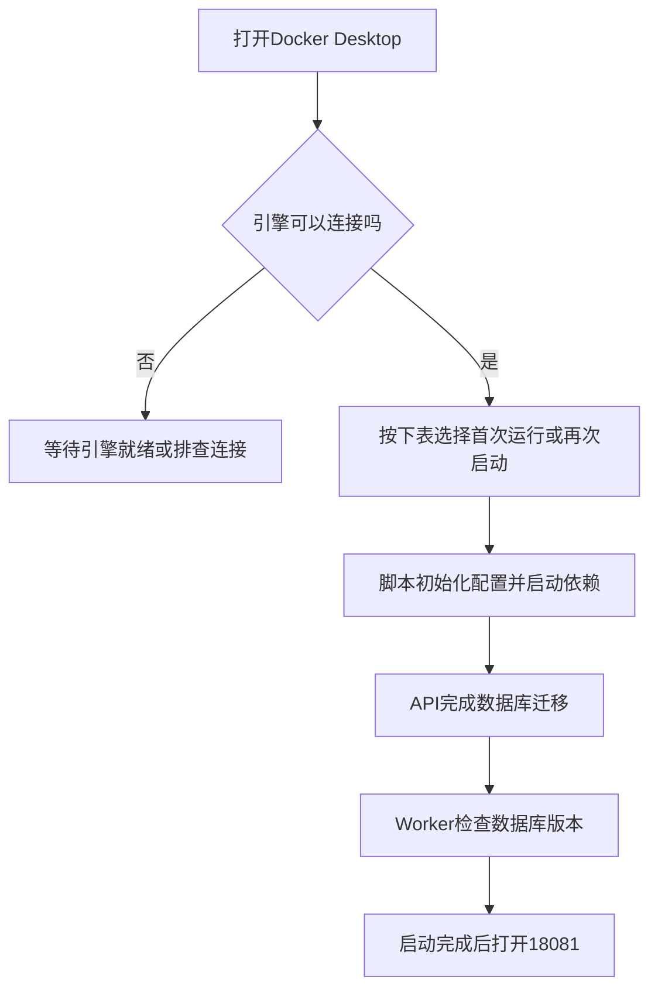
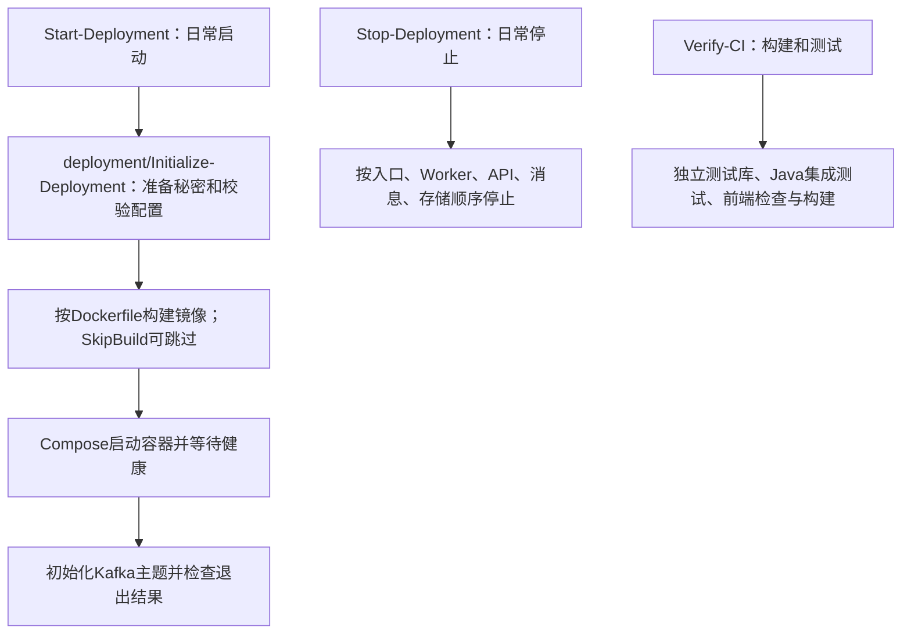

# TestFlow 运行与部署

**只想打开项目使用：按第1节运行完整 Docker 环境。** 只有修改代码和断点调试时，才使用文末的开发调试附录。本文件是项目启动、停止和环境配置的唯一说明入口。

| 方式 | 用途 | 浏览器入口 | 应用运行位置 | 初始账号 |
| --- | --- | --- | --- | --- |
| 完整 Docker（推荐） | 日常使用、演示、交付复现 | http://127.0.0.1:18081 | API、Worker、前端和依赖均在容器 | admin |
| 本机开发 | IDEA调试、前端热更新 | http://127.0.0.1:5173 | Java和Vite在Windows，依赖在容器 | local-admin |

两种方式使用独立的数据卷和凭据，账号或项目不互通。16GB电脑每次只运行一套，避免内存不足。

## 1. 首次运行或代码更新

### 1.1 准备环境

安装并打开 **Docker Desktop（Linux引擎）**，使用 **PowerShell 7**，切换到项目根目录。完整部署不要求宿主机安装Java、Maven或Node；第一次构建需要网络下载依赖和镜像。

Windows自带的Windows PowerShell 5.1不能执行这些脚本。首次使用时，在现有终端安装独立的PowerShell 7（只需一次）：

```powershell
winget install --id Microsoft.PowerShell --source winget
```

安装完成后，关闭旧终端，从开始菜单打开PowerShell 7。执行 `$PSVersionTable.PSVersion`，确认Major为7。安装方法见[微软官方说明](https://learn.microsoft.com/en-us/powershell/scripting/install/install-powershell-on-windows)。

**使用IDEA项目终端也可以：** 安装后重启IDEA，在Settings → Tools → Terminal中将Shell path设为`pwsh.exe`，关闭旧终端标签并新建终端，再检查版本。终端中的当前目录应为项目根目录。不需要使用Codex内部运行时路径。

**Docker Desktop需要提前手动打开。** 等待Linux引擎就绪后再运行项目启动脚本；脚本负责启动项目容器，不负责打开Docker Desktop。

先执行 `docker version`。输出应同时包含Client和Server；只有Client说明引擎还没有就绪。使用 `docker compose version` 确认Compose可用。



脚本会等待服务就绪，失败会报错。正常结束时会提示访问地址；无需再手工启动API、Worker或前端。

### 1.2 选择一条命令

以下命令均在项目根目录执行，**不是从上到下全部执行**。

| 你现在要做什么 | 命令 | 什么时候使用 |
| --- | --- | --- |
| 首次运行，或修改代码后更新 | `./scripts/Start-Deployment.ps1 -Demo` | 构建镜像后启动整套服务 |
| 关闭后再次打开 | `./scripts/Start-Deployment.ps1 -Demo -SkipBuild` | 已有镜像，并且代码和部署配置未更新 |
| 停止项目 | `./scripts/Stop-Deployment.ps1` | 结束使用，保留数据和镜像 |
| 项目停止后退出Docker Desktop（可选） | `docker desktop stop` | 不再使用其他Docker项目时释放引擎资源 |

`-Demo` 会额外启动本机合成测试目标，方便验证接口执行。它**不会创建项目、用例或运行数据**。这里统一保留该参数，不再提供多套日常启动写法。

`-SkipBuild` 只省略构建，不检查镜像是否对应最新源码。缺镜像、代码改动或部署文件更新时，请选择第一行。

### 1.3 登录与成功判断

打开 <http://127.0.0.1:18081>，初始账号为 `admin`。随机初始密码在本机文件 `.local/deploy-secrets.json` 的 `AdminPassword` 字段，用编辑器本地查看；不要把内容提交、截图或贴入日志。

启动成功应满足：脚本正常结束，登录页面可访问，登录后能进入工作空间。首次空库没有业务项目是正常情况，管理员可以在页面创建项目。

再次启动不会重置已有账号密码。若后来在页面改过密码，应使用修改后的密码，不能把本机初始密码文件当作当前密码来源。

## 2. 日常停止、再次运行和更新

结束使用时，先停止提交新运行，尽量等待当前运行结束，再使用上表的停止命令。脚本按 **Nginx入口 → Worker/演示目标 → API → Kafka → Redis → MySQL** 的顺序停止。

- 普通停止保留镜像、命名数据卷和`.local`凭据，下一次使用上表的再次启动命令。
- 修改代码后，先停止项目，再使用上表的构建启动命令。只刷新浏览器不会更新容器内程序。
- 更新前端后，已打开的标签页仍可能运行旧脚本。取消未保存编辑后刷新，必要时按`Ctrl+F5`。
- 不要删除数据卷来解决连接、密码或迁移问题；不要执行`down -v`。

数据库升级由API唯一执行。更新前停止旧Worker，保留数据库与加密密钥，API迁移成功后再运行匹配版本Worker。当前数据库版本为6，不承诺不同版本任意混跑或自动回退。

## 3. 演示数据与自动化测试是另外两件事

| 操作 | 做了什么 | 是否为启动必需 |
| --- | --- | --- |
| 上表的`-Demo` | 启动返回synthetic标记的HTTP目标 | 仅演示目标需要 |
| 页面创建项目、环境、用例、计划 | 配置自己的测试对象 | 首次使用时按需配置 |
| 部署冒烟工具 | 创建带时间标记的合成项目，并真实执行用例和计划 | 否，执行方法见[测试说明](TESTING.md#2-如何执行测试) |
| 本机开发演示初始化 | 添加缺失的开发演示定义，不自动执行 | 只适用于附录A的本机开发方式 |

自动化测试会增加记录，故障测试还会停止或重启服务。不要把测试命令加入每次启动步骤，也不要在有真实运行时执行故障验证。

## 4. 启动失败时查哪里

| 现象 | 先检查 | 正确处理 |
| --- | --- | --- |
| Docker只有Client信息或无法连接 | Docker Desktop是否打开、是否使用Linux引擎 | 等引擎就绪，不要重置数据 |
| 下载镜像、Maven或npm依赖失败 | 网络、代理和错误日志 | 恢复下载后重试；首次构建不能保证离线完成 |
| 18081无法打开 | 启动脚本是否成功、端口是否被占用 | 先检查服务状态，不要直接放宽防火墙或SSRF |
| 登录密码不对 | 当前使用18081还是5173、账号是否后来改密 | 区分两套环境；重复初始化不会重置密码 |
| Worker提示schema不匹配 | API迁移是否成功、Worker镜像是否更新 | 使用同一套版本重新构建，不跳过版本检查 |
| 页面还是旧版 | 容器是否更新、旧标签页是否刷新 | 先完成更新，再取消编辑并强制刷新 |
| Kafka不可用，质量趋势滞后 | 发布和消费恢复状态 | 运行和原报告仍可用；恢复后补齐，不重新执行HTTP |
| 内存不足或容器退出 | 是否同时运行开发栈、整栈及测试 | 先停止另一套环境，不无限增加线程或连接池 |

仅查看状态可用 `docker compose -f compose.deploy.yml ps`。定位问题时按服务查看日志，不将含敏感请求或连接信息的原始日志公开。

## 5. 数据、网络与运行边界

### 5.1 哪些数据必须保留

| 位置 | 内容 | 注意 |
| --- | --- | --- |
| MySQL命名卷 | 账号、定义、任务、快照、结果、Outbox及统计 | 以数据库记录为准，不能随意清表 |
| Redis命名卷 | 会话及限速数据 | AOF everysec不等于断电零丢失 |
| Kafka命名卷 | 消息与消费位点 | 单节点单副本，不是高可用 |
| `.local/deploy-secrets.json`及同名秘密目录 | 随机密码、加密和HMAC密钥 | 不入Git；密钥丢失会导致旧快照不可用 |

当前没有自动归档清理或独立备份恢复演练。命名卷不是独立备份，不能把保留数据卷称为已经完成备份方案。

### 5.2 Worker应该访问哪个地址

| Worker位置 | 受测接口位置 | 地址示例 |
| --- | --- | --- |
| Windows进程 | Windows本机 | `http://127.0.0.1:8088` |
| Docker容器 | 同一Compose网络 | `http://demo-target:8088` |
| Docker Desktop容器 | Windows宿主机 | `http://host.docker.internal:18089` |

地址必须先获得项目内的精确目标授权。本机用LOOPBACK策略，私网或容器目标用PRIVATE策略；授权不意味着可以访问平台控制面或元数据地址。宿主机接口还需要监听容器可达地址，并符合防火墙规则。

容器内localhost指容器自身，Windows进程不使用Compose服务名。完整部署仅发布Nginx回环18081，不发布数据库、Redis、Kafka或API端口；更改入口端口时同步`TF_CONTROL_PORTS`。

### 5.3 服务的启动职责

MySQL/Redis就绪后，由初始化步骤准备账号；API使用独立迁移凭据执行Flyway，业务连接没有DDL权限；Worker只读检查schema并登记心跳，不执行迁移。Kafka初始化独立进行，应用执行与报告不以Kafka可用为前提。但整栈启动脚本仍等待Kafka健康，Kafka启动失败会使脚本报错；这与应用已经运行后允许Kafka故障是两回事。

Nginx托管前端并转发`/api/`，拒绝公开Actuator。API readiness检查数据库和Redis，不包含Kafka；Worker没有Web端口，通过数据库及容器心跳文件观察健康。unhealthy不是Docker自动重启的触发条件，进程退出才受重启策略处理。

## 6. 工具之间怎样配合

scripts根目录只有三个入口：启动完整部署、停止完整部署、统一构建测试。辅助脚本按用途放进子目录，不能把目录中的文件从头到尾执行一遍。



Initialize-Deployment由启动入口自动调用，只准备配置，不负责完整启动。Dockerfile定义镜像如何构建，Compose定义容器网络、数据卷和依赖，PowerShell脚本组织执行顺序。部署构建使用当前源码，不会把Windows上的运行进程搬入容器。

| 子目录 | 负责什么 | 何时使用 |
| --- | --- | --- |
| `dev/` | 开发依赖、API/Worker启动、合成演示定义 | 修改代码、IDEA调试时 |
| `deployment/` | 部署配置初始化、部署状态采集 | 初始化由主入口调用；观察工具按需使用 |
| `test/`及`test/support/` | 工具、进程、浏览器、网络及故障回归 | 按测试说明使用，不作为普通启动步骤 |
| `benchmark/` | SQL、Outbox、资源和HTTP测量 | 专门安排的性能或短时观察 |
| `lib/` | 路径、环境与HTTP公共函数 | 由其他工具调用，不作为日常入口 |
| `fixtures/` | 共享合成HTTP目标 | 开发演示、容器及测试使用 |

各PowerShell脚本的帮助写明前提、参数、数据修改和结果位置。旧阶段命名入口已归并或改为业务名称；使用本手册中的当前路径，不混用历史报告里的命令。

例如只查看API启动工具的完整帮助，可以执行 `Get-Help ./scripts/dev/Start-Api.ps1 -Full`；查看帮助不会启动API。

## 附录A：仅在开发调试时使用

### A1. 工具与初始化

开发时并非所有服务都是Windows进程：

| 服务 | 开发调试 | 完整部署 |
| --- | --- | --- |
| API与Worker | Windows Java进程，可在IDEA调试 | 分开的Java容器 |
| 前端服务 | Windows Vite开发服务器 | Nginx容器提供构建后的静态文件 |
| MySQL、Redis、Kafka | 本机Docker Desktop的Linux容器 | 部署环境自己的Linux容器与数据卷 |

需要Java21、PowerShell7、Node22.12+、Docker Desktop Linux引擎；容器和CI使用Node24.14.0。使用仓库Maven Wrapper3.9.11，不必额外安装Maven。不要同时运行完整部署。

初始化开发依赖并构建：

```powershell
./scripts/dev/Initialize-Local.ps1
./mvnw.cmd -B -ntp clean verify
npm --prefix frontend ci
npm --prefix frontend run build
```

该步骤准备MySQL/Redis、开发库`testflow`及专用测试库`testflow_test`。普通Maven verify不运行集成测试，完整测试见测试说明。需要质量趋势或Kafka专项测试时，另外执行 `./scripts/dev/Initialize-Kafka.ps1`。

开发随机凭据在`.local/dev-secrets.json`。开发管理员为`local-admin`，初始密码字段为`AdminPassword`；测试管理员和密码单独保存。不要与完整部署凭据混用。

### A2. 分别启动三个开发进程

```powershell
# 终端A：API，默认8080
./scripts/dev/Start-Api.ps1
# 终端B：API就绪后启动Worker
./scripts/dev/Start-Worker.ps1
# 终端C：Vite
Set-Location frontend
npm run dev
```

浏览器访问 <http://127.0.0.1:5173>。IDEA调试时导入根pom.xml，SDK设为21；API和Worker使用同样的分角色配置，不添加另一套硬编码账号。Worker无Web监听。

本机演示目标和定义只在需要时准备：另一个终端执行 `java --source 21 scripts/fixtures/DemoTarget.java 8088`，目标就绪后，在项目根目录执行 `./scripts/dev/Initialize-Demo.ps1`。它不覆盖已有定义、不自动提交运行。

### A3. 停止开发环境

先在对应终端Ctrl+C停止Vite、Worker和API。Windows会锁定运行中的JAR，重新打包前必须停止；重新npm ci前也应停止Vite。然后在根目录停止开发依赖，保留卷：

```powershell
. ./scripts/lib/LocalEnvironment.ps1
Set-TestFlowDockerEnvironment
docker compose --profile quality stop --timeout 35
```

不要批量结束所有Java或Node进程，以免关闭用户的其他工程。

### A4. 开发地址

| 服务 | Windows访问地址 |
| --- | --- |
| 前端 | 127.0.0.1:5173 |
| API | 127.0.0.1:8080 |
| MySQL | 127.0.0.1:13306（容器内部3306） |
| Redis | 127.0.0.1:6379 |
| Kafka | 127.0.0.1:19092 |

初始化时可用`-MysqlPort/-RedisPort`避免冲突；更改API端口需同步前端`TF_API_URL`。

### A5. 所有权浏览器专项的独立环境

**只在执行所有权浏览器回归时使用，不是另一套日常启动方法。** 先完成附录A1构建并停止普通开发API、Worker和Vite。需要已有可调用的`playwright-cli`及Edge；未配置浏览器工具时不要声称已完成此项测试。

在项目根目录执行 `./scripts/test/Test-Ownership.ps1 -KeepApi`，工具会验证并保留测试API18080及新夹具。另一个终端运行测试专用Vite：

```powershell
$env:TF_API_URL = 'http://127.0.0.1:18080'
npm --prefix frontend run dev
```

然后创建脚本需要的命名浏览器会话：

```powershell
playwright-cli -s=ownership open http://127.0.0.1:5173 --browser msedge
```

各测试阶段的执行方法见[测试说明](TESTING.md#22-独立进程专项)。不要额外运行普通`Start-Api.ps1`，否则测试页面可能连到错误数据库。

结束后执行 `playwright-cli -s=ownership close`，Ctrl+C停止该Vite终端。测试API由脚本隐藏启动，其PID记录在`.local/verification/ownership/api.pid`；在任务管理器核对该PID的命令行、启动时间及本项目JAR路径后，只结束这一个测试API。该终端的`TF_API_URL`只对当前进程环境生效，关闭终端后不会影响普通开发。

### A6. 容器访问Windows宿主机的专项目标

只有执行宿主机网络回归时才需要：完整部署带演示目标启动后，另开Windows终端在项目根目录启动合成目标，使容器可以访问它。

```powershell
$env:TF_DEMO_BIND_ADDRESS = '0.0.0.0'
java --source 21 scripts/fixtures/DemoTarget.java 18089
```

测试工具通过host.docker.internal:18089访问，仍需精确目标授权与SSRF校验；防火墙应仅允许测试所需访问。结束后Ctrl+C停止该目标并关闭终端，不长期对局域网开放。专项测试命令见测试说明。

### A7. 开发完成后怎样切换到Docker部署

1. 按A3停止开发应用及依赖，IDEA可以保持打开。
2. 回到项目根目录，按第1.2节选择“首次运行或修改代码后更新”，重新构建镜像；不使用SkipBuild。
3. 启动入口自动调用部署初始化、构建镜像、启动容器和初始化主题，无需单独运行Initialize-Deployment。
4. 访问18081，使用部署环境的账号和数据。开发库、密码及项目不会自动复制过去；更新已有部署也不会重置管理员密码。

## 附录B：配置与资源速查

配置由脚本或Compose秘密文件注入，以下不提供真实值。

| 配置 | 使用方与含义 |
| --- | --- |
| TF_DB_URL / TF_DB_USERNAME / TF_DB_PASSWORD | API/Worker分角色业务连接 |
| TF_MIGRATION_DB_USERNAME / TF_MIGRATION_DB_PASSWORD | 仅API迁移使用 |
| TF_REDIS_HOST / TF_REDIS_PORT / TF_REDIS_PASSWORD | API会话与限速 |
| TF_SECRET_KEY / TF_SNAPSHOT_HMAC_KEY | API/Worker共享的两个独立密钥，不能复用 |
| TF_BOOTSTRAP_ADMIN_USERNAME / TF_BOOTSTRAP_ADMIN_PASSWORD | API仅在空用户表创建管理员，不重置已有账号 |
| TF_API_PORT / TF_BIND_ADDRESS / TF_COOKIE_SECURE | API监听、端口和Cookie设置；默认本机HTTP |
| TF_SESSION_NAMESPACE / TF_LOGIN_RATE_PREFIX | 开发与测试的命名空间隔离 |
| TF_QUALITY_ENABLED / TF_KAFKA_BOOTSTRAP_SERVERS / TF_QUALITY_TOPIC / TF_QUALITY_GROUP_ID | API质量统计；开发启动脚本默认启用，Worker不使用 |
| TF_RUN_CONCURRENCY / TF_HTTP_CONCURRENCY | 单Worker运行槽/HTTP预算，默认2/4 |
| TF_LEASE_MS / TF_HEARTBEAT_MS / TF_POLL_INTERVAL_MS | 默认租约30000、续租5000、轮询1000毫秒 |
| TF_RUN_TIMEOUT_MS / TF_RECOVERY_INTERVAL_MS | API默认运行600000、维护扫描5000毫秒 |
| TF_CONNECT_TIMEOUT_MS / TF_RESPONSE_MAX_BYTES / TF_SNAPSHOT_MAX_BYTES | 默认3000毫秒、1MiB响应、4MiB快照 |
| TF_CONTROL_PORTS | 附加禁止受测请求访问的平台端口 |

完整部署API heap384MiB/Hikari8，Worker heap256MiB/Hikari3，MySQL容器1GiB，Redis256MiB，Kafka1GiB；这些是预算，不是生产容量保证。容器标准输出按10MiB×3轮转。详细资源上限以[Compose文件](../compose.deploy.yml)为准。

文件secret不等于加密秘密管理服务。主机管理员仍能读取文件；不要将密钥放入Git、前端配置或数据库。当前入口是回环HTTP，尚无公网HTTPS、可信多代理链、自动备份和生产高可用承诺。
