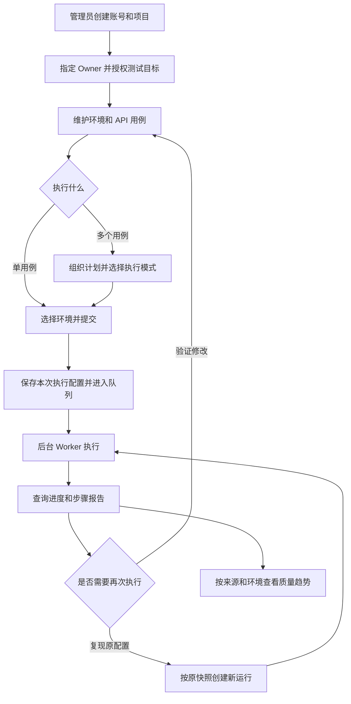
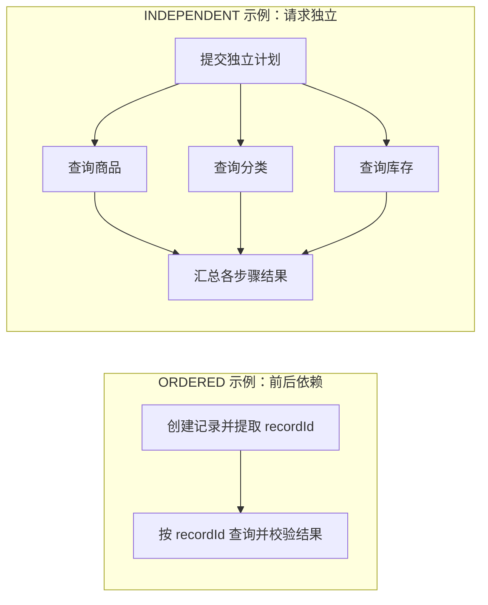
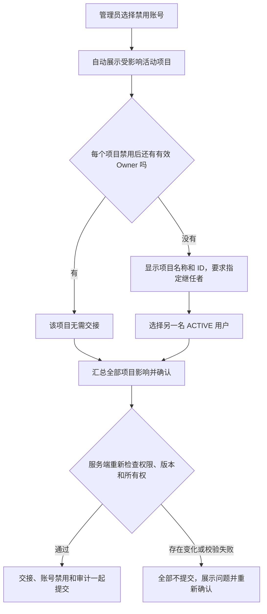

# TestFlow 需求分析

TestFlow 帮助个人开发者和小型研发团队管理 API 回归测试：维护用例、组织计划、后台执行，再从报告和趋势中判断接口质量。本文说明已经实现的产品行为和业务规则。

系统实现见[架构设计](ARCHITECTURE.md)，数据结构见[数据库设计](DATABASE.md)，调用方式见[接口设计](API.md)，启动操作统一见[部署手册](DEPLOYMENT.md)。

## 1. 为谁解决什么问题

| 用户 | 典型问题 | TestFlow 提供的能力 |
| --- | --- | --- |
| 后端开发者 | 接口改动后，需要反复验证同一组请求 | 保存可重复执行的用例，查看请求、断言和错误明细 |
| 测试人员 | 登录、创建、查询等接口存在先后依赖 | 用有序计划传递前一步响应中的变量 |
| 项目负责人 | 单次通过不能说明最近质量，失败也可能只执行了部分步骤 | 查看历史、执行覆盖率和质量趋势，回到原始报告定位问题 |
| 系统管理员 | 账号离职或禁用后，项目可能无人管理 | 在专用管理入口查看所有权、指定继任者并完成账号交接 |

受测接口可以位于本机、内网或获授权公网。能够连接不代表可以测试，执行目标必须经过项目访问授权。账号由管理员创建，不开放公众注册。

## 2. 功能范围

| 功能 | 当前支持 |
| --- | --- |
| 项目和权限 | 创建项目、成员角色、归档与激活、目标访问授权、账号与所有权治理 |
| 环境 | 基础地址、普通变量、敏感变量；敏感值加密保存且不回显 |
| API 用例 | HTTP 方法、相对路径、Query、Header、JSON 正文、声明式断言和响应值提取 |
| 运行与计划 | 单用例、ORDERED 有序计划、INDEPENDENT 独立计划、失败停止、取消 |
| 报告与追溯 | 历史筛选、步骤明细、执行配置快照、按原快照重跑及原运行关联 |
| 质量分析 | 按来源、环境和日期汇总趋势，展示统计延迟，支持失败诊断和统计补齐 |
| 本地交付 | Windows 开发、Docker Compose 单机部署、自动化测试和 CI 配置 |

暂不支持定时任务、导入导出、公开报告分享、第三方通知、任意脚本、文件上传、非 HTTP 协议、完整 JSONPath、条件循环流程树、压力测试、缺陷管理、组织多租户、自定义角色和执行集群。实际验证范围见[测试说明](TESTING.md)。

## 3. 一次完整回归怎么完成

提交后立即返回运行标识，页面可以查询排队和执行进度，无需等待全部请求完成。报告直接展示已保存的结果；质量统计异步更新，统计延迟不会阻止查看原报告。

每次提交保存一份不可修改的执行配置，称为**执行快照**。之后修改用例或环境，不会改变已经提交的运行；历史报告因此能够解释“当时到底测了什么”。

## 4. 用例、计划和重跑规则

### 4.1 环境和 API 用例

- 环境提供基础地址和具名变量。普通变量可以在提交时覆盖；敏感变量通过专门配置维护，不能通过普通覆盖参数修改。
- 用例请求使用环境基础地址和相对路径。正文支持无正文 `NONE` 或 JSON `JSON`，不支持表单、文件、任意二进制和脚本。
- 断言支持状态码、响应头存在或等值、JSON 字段存在或等值、耗时上限。JSON 路径仅支持字段名和数组下标，例如 `$.data.id`，不支持过滤、递归或脚本。
- 提取器从 JSON 响应中提取一个标量值，例如字符串、数字或布尔值；可以把敏感提取结果标记为秘密。
- 认证通过受控请求头和敏感环境变量配置，不提供完整的 OAuth 流程设计器。

### 4.2 两种计划怎么选

一个计划由多个步骤组成，每步引用一个用例。同一用例可以重复引用，各步骤分别记录结果；仅启用步骤进入本次运行，没有启用步骤的计划不能提交。

| 对比项 | ORDERED：有序计划 | INDEPENDENT：独立计划 |
| --- | --- | --- |
| 适用场景 | 前后请求有依赖，例如创建后查询 | 请求互不依赖，例如分别检查多个查询接口 |
| 执行方式 | 按定义顺序逐步执行 | 在设定并发上限内执行，不保证完成顺序 |
| 环境变量 | 支持 `${env.name}` | 支持 `${env.name}` |
| 前一步提取的变量 | 支持 `${run.name}` | 禁止引用其他步骤的运行变量 |
| 失败停止 | 开启后，剩余未开始步骤不执行 | 开启后停止新步骤，已开始的请求继续收集结果 |
| 报告顺序 | 按步骤定义顺序展示 | 仍按定义顺序展示，同时保留真实起止时间 |

示例说明依赖关系，并不表示平台支持任意分支工作流。计划只有上述两种模式；独立模式受到并发预算限制，不保证图中的请求同时开始。

运行变量只属于本次运行，不写回环境、不跨运行共享。步骤通过且结果保存成功后，才发布该步骤的全部提取值；断言或提取失败时不发布部分结果，并清除该失败步骤声明名称的旧运行值。后续引用缺失变量的步骤记为执行错误，不带未替换的占位符发送请求。

管理端新建计划默认勾选失败停止，也可以关闭。直接调用 API 时应显式传入 `failFast`，省略时为 false。被跳过的步骤不能记为成功；取消、超时和 Worker 中断也不能把未知结果猜成成功。状态和故障处理的完整规则统一见[架构设计](ARCHITECTURE.md)。

### 4.3 当前配置执行与原快照重跑

| 操作 | 使用的配置 | 历史关系 |
| --- | --- | --- |
| 按当前配置执行 | 读取当前用例、计划和环境，生成新快照 | 新建一次运行 |
| 按原快照重跑 | 使用原运行保存的配置，不复制上次提取出的动态值 | 新建运行并关联原运行，原报告不变 |

重跑仍需满足当前项目权限和目标授权。原快照不能解密或校验时明确失败，不自动替换成当前配置。暂不支持只重跑计划中的失败步骤，以免遗漏创建、登录等前置依赖。

取消表示尽力停止后续请求和正在执行的调用，不能撤销目标系统已经发生的操作。平台默认不自动重发 HTTP 请求；结果不确定时，由用户判断是否新建运行重跑。

## 5. 用户、权限和账号交接

### 5.1 平台身份与项目角色分开

| 身份或角色 | 可执行操作 |
| --- | --- |
| 系统管理员 | 创建账号和项目、授权测试目标、查看项目治理摘要、处理所有权、禁用账号 |
| 项目 OWNER | 管理成员、归档和激活项目；具有维护和查看能力 |
| 项目 MAINTAINER | 维护环境、用例、计划，提交、取消、重跑，补齐和重放质量统计 |
| 项目 VIEWER | 查看配置、历史、脱敏报告、质量趋势和本项目统计失败记录 |

系统管理员不会自动获得项目业务权限。例如管理员在某项目只是 VIEWER，仍不能编辑该项目用例；但可通过“平台管理 → 项目管理”处理所有权。专用入口仅展示治理所需的项目、账号摘要，不开放秘密或业务报告。

### 5.2 有效 Owner 与禁用规则

**有效 Owner = 角色为 OWNER、账号为 ACTIVE 的成员。** 每个活动项目至少保留一名有效 Owner；最后一名有效 Owner 不能降级或移除，最后一名有效系统管理员也不能禁用。

- 禁用影响自动加载。加载失败、仍在加载或缺少必要继任者时不能提交；并发变化时保留仍有效的选择，刷新影响后要求再次确认，不自动选择继任者或重试禁用。
- 继任者可以是现有成员或非成员，交接后成为 OWNER；明确交出的原 OWNER 降为 MAINTAINER。多个项目交接和禁用必须全部成功或全部失败。
- 禁用后仍有其他有效 Owner 的项目不强制交接，保留原成员角色；重新启用账号后按保留角色恢复权限，旧登录会话不会恢复。
- 归档项目不阻止账号禁用，但重新激活前必须有有效 Owner，必要时先由管理员治理。
- “项目管理”中的独立交接不会自动禁用账号。自身降级、移除自身前必须提示将失去的权限；取消不发送修改请求，成功后刷新可见项目和操作。

## 6. 报告和质量指标

### 6.1 报告能回答什么

报告展示运行来源、环境、执行人、配置版本、时间、结束原因、分类计数，以及逐步脱敏请求、响应、断言、提取摘要和错误。历史支持按项目内来源、环境、提交时间、状态和结论筛选，并能沿重跑关系找到原运行。

“执行流程已经结束”和“测试通过”分别展示。尚未结束时结论为空；结束后展示通过 `PASSED`、失败 `FAILED` 或未完整执行 `INCOMPLETE`。跳过、取消和未知结果均不计为通过；具体状态含义见[架构设计](ARCHITECTURE.md)。

### 6.2 统一计算口径

本节是报告与趋势指标公式的唯一来源。设 `N` 为快照中的步骤总数，`P/F/E/S/C/U` 分别为通过、断言失败、执行错误、跳过、取消、未知结果数量；`D=P+F+E` 为已有明确结果的步骤数。

| 指标 | 公式 | 用途 |
| --- | --- | --- |
| 终态进度 | `(P+F+E+S+C+U)/N × 100%` | 有多少步骤已经结束 |
| 已知结果覆盖率 | `D/N × 100%` | 计划中多少步骤有明确执行结果 |
| 通过率 | `P/D × 100%` | 已知结果中多少通过 |
| 断言失败率 | `F/D × 100%` | 已知结果中多少断言失败 |
| 执行错误率 | `E/D × 100%` | 已知结果中多少发生执行错误 |

分母为零时显示 `N/A`，不能显示为全部通过或零失败。各分类互斥；未开始和执行中不计入终态进度。断言失败率不能用 `100% - 通过率` 代替，因为还存在执行错误。

例如 10 个步骤中 3 个通过、1 个断言失败、6 个跳过：终态进度为 100%，已知结果覆盖率为 40%，通过率为 75%。75% 只描述已经得到结果的部分，不能据此判断整份计划质量良好。

### 6.3 质量趋势与统计修复

质量趋势按用例或计划、环境和完成日期查询，默认近 30 个 UTC 自然日，最多 90 天。先汇总各分类数量再计算比例，不平均多次运行的通过率。默认仅统计正常结束的运行；取消、超时和中断单列，可主动纳入。正常失败停止仍属于正常结束且失败的运行。

页面同时展示已统计运行、终态运行、待补齐数量和更新时间。统计落后时明确说明只代表已经处理的运行，不能把待处理数据算成通过或零失败；没有可计算结果时显示 `N/A`。

VIEWER 可以查看趋势和本项目统计失败记录，MAINTAINER/OWNER 可以补齐或重放统计事件。修复只更新统计，不重新调用受测接口，也不修改原报告；无法确认项目归属的失败记录仅由系统管理员查看。异步实现和恢复机制见[架构设计](ARCHITECTURE.md)。
